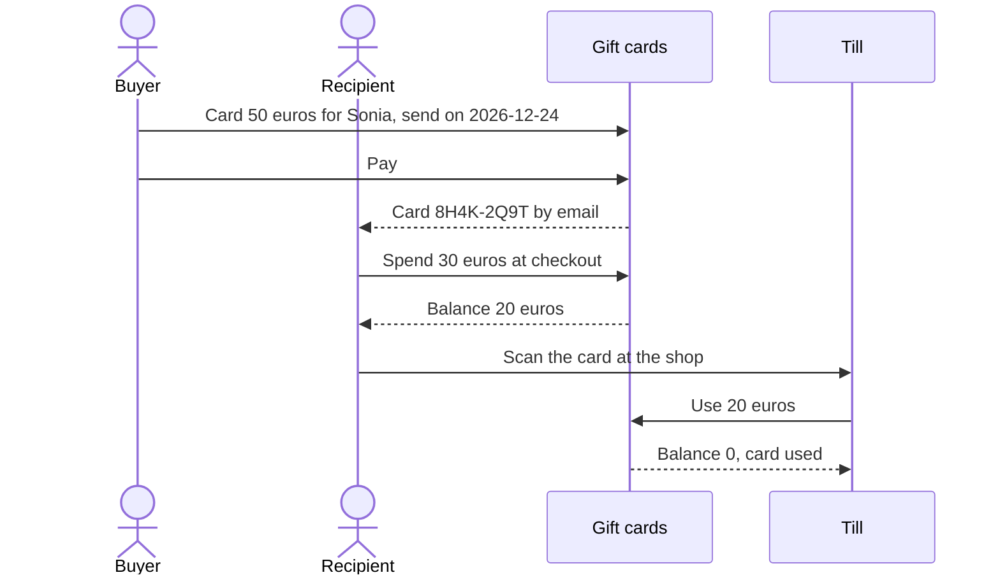

🏠 [Specs](../../../../README.md) › 🧩 [Functional capabilities](../../../README.md) ›
🛍️ [F11 Online shop (plugin)](../../README.md) › 📝 [Use cases](../README.md) › 📝 [Use cases: FL-F11-11](README.md) ›
📝 UC-F11-32 Sell and redeem gift cards online

# 📝 UC-F11-32 Sell and redeem gift cards online

**Status:** ✅ specified

## Summary

A shopper buys a gift card for an amount and sends it to a recipient by email on a chosen date, with a message. The
recipient spends it at checkout by typing its code, or at a till by showing it, and the balance is the same in both: a
card spent partly online has the rest at the till. The store manager sees the cards sold and their balances.

## Personas

- [U09 Customer](../../../../01-users/personas/u09-customer.md), who buys, receives or spends a card, on a phone
- [U23 Store manager](../../../../01-users/personas/u23-store-manager.md), who follows the cards and blocks a lost or
  fraudulent one

## Goal

Gift cards sell online, and one balance is spent anywhere, with no card lost between the shop and the tills.

## Trigger

A shopper buys a gift card, or a holder enters a card code at checkout.

## Frequency

Daily, with peaks before holidays.

## Preconditions

- The shop sells gift cards as products with amounts and a validity
  ([E-F11-26 Online gift card](../../data/e-f11-26-online-gift-card.md)).
- The tills read the same card balances
  ([E-F10-10 Loyalty card and gift card](../../../f10-point-of-sale/data/e-f10-10-loyalty-card-and-gift-card.md),
  [UC-F10-07](../../../f10-point-of-sale/use-cases/03-after-sales/uc-f10-07-use-loyalty-gift-cards-and-e-wallet.md)).
- A payment provider is connected ([E-F11-06 Payment provider](../../data/e-f11-06-payment-provider.md)).

## Postconditions

- **Succeeded:** the card is paid, delivered and spent until empty or expired, with its balance kept up to date for shop
  and tills ([E-F11-26 Online gift card](../../data/e-f11-26-online-gift-card.md)).
- **Failed:** no card is issued or no balance is spent, and the shopper is told why.

## Main flow

1. The buyer opens Gift cards
   ([S-F11-31](../../screens/11-donations-gift-cards-and-cross-border/s-f11-31-gift-cards-online.md)), picks an amount
   and writes the recipient's email, a message and a delivery date.
2. The buyer pays at checkout ([UC-F11-05](../02-shop-and-check-out/uc-f11-05-check-out.md)); the card is issued with a
   random code that cannot be guessed.
3. On the delivery date the recipient receives the card by email, with its code and a link to spend it.
4. At checkout, the holder enters the code; the amount used, up to the balance and the order total, is taken off the
   order.
5. At a till, the cashier scans the same card and the same balance is used
   ([BR-F11-27](../../business-rules/br-f11-27-one-gift-card-balance-across-shop-and-tills.md)).
6. The store manager sees the cards sold, spent and expiring, and blocks a card reported stolen.

## Alternative flows

- 1a. The buyer sends the card to themselves, to print or to give by hand.
- 4a. The order is below the balance: the rest stays on the card; above the balance, the shopper pays the difference by
  another means.
- 6a. A card reaches its end date: its remaining balance follows the legal rules for the validity of the card.

## Error flows

- 4e. The code is wrong or the card is used up or blocked: refused with the reason, and repeated wrong tries lock the
  entry for a while.
- 2e. The payment fails: no card is issued ([UC-F11-06](../02-shop-and-check-out/uc-f11-06-pay-online.md)).
- 5e. The till is offline: it uses the last balance known and syncs later
  ([BR-F10-06](../../../f10-point-of-sale/business-rules/br-f10-06-offline-keeps-selling.md)).
- Any step: a service does not answer; the call is retried first
  ([BR-F3-32](../../../f03-assistant/business-rules/br-f03-32-retry-before-an-error.md)), then the message follows the
  error pattern ([D122](../../../../06-decisions/ux/d122-error-message-standard.md)) and the card and its balance stay
  as they were.

## Business rules

- [BR-F11-27 One gift-card balance across shop and tills](../../business-rules/br-f11-27-one-gift-card-balance-across-shop-and-tills.md)
- [BR-F10-12 Loyalty needs a customer, vouchers follow VAT rules](../../../f10-point-of-sale/business-rules/br-f10-12-loyalty-and-vouchers.md)
- [BR-F11-16 Risky orders are authenticated or held](../../business-rules/br-f11-16-risky-orders-are-authenticated-or-held.md)

## Entities

- [E-F11-26 Online gift card](../../data/e-f11-26-online-gift-card.md): created, activated, spent, expired, blocked
- [E-F10-10 Loyalty card and gift card](../../../f10-point-of-sale/data/e-f10-10-loyalty-card-and-gift-card.md): the
  same balance, read by the tills
- [E-F11-05 Checkout](../../data/e-f11-05-checkout.md): read
- [E-F11-09 Customer account](../../data/e-f11-09-customer-account.md): read

## Permissions

A buyer sees the cards they bought and a holder the cards they received. The store manager sees all cards, blocks a card
and adjusts a balance with a reason. A cashier reads and spends a balance.

## Notifications

- The recipient, by email: the card, on the delivery date.
- The buyer, by email: the card was delivered and later spent, if they asked.
- The store manager, in the app: repeated wrong tries on a card.

## Audit events

Card issued, delivered, spent, expired, blocked and adjusted, with the amount, the channel (shop or till) and who did
it.

## AI involvement

None: balances are never changed by the AI assistant.

## API, MCP and A2A exposure

T5 operations on cards for the shop and the tills; no MCP tool and no A2A skill.

## Screens

- [S-F11-31 Gift cards online](../../screens/11-donations-gift-cards-and-cross-border/s-f11-31-gift-cards-online.md)

## Flowchart

See
[FL-F11-11 Donations, wishlists, gift cards and cross-border](../../flows/fl-f11-11-donations-gift-cards-and-cross-border.md#flowchart).

## Sequence diagram

## Acceptance criteria

1. **Given** a card of 50 euros **when** the recipient spends 30 euros online **then** the balance is 20 euros
   everywhere.
2. **Given** the same card **when** the cashier scans it **then** 20 euros can be used and no more.
3. **Given** a wrong code entered 5 times **when** the sixth try **then** the entry is locked for a while.
4. **Given** a card past its end date **when** it is used **then** it is refused.
5. **Given** a card reported stolen **when** the store manager blocks it **then** no channel accepts it.

## Non-functional notes

A balance used online is visible at every till within 5 seconds.

## Regulatory references

The validity and the VAT of gift cards and vouchers follow
[CR-FR-097](../../../../10-country-packs/france/consumer/cr-fr-097-gift-card-validity.md) and
[CR-FR-013](../../../../10-country-packs/france/tax-and-vat/cr-fr-013-vouchers-vat.md).

## Related use cases

- [UC-F10-07 Use loyalty, gift cards and e-wallet](../../../f10-point-of-sale/use-cases/03-after-sales/uc-f10-07-use-loyalty-gift-cards-and-e-wallet.md)
- [UC-F11-05 Check out](../02-shop-and-check-out/uc-f11-05-check-out.md)
- [UC-F11-06 Pay online](../02-shop-and-check-out/uc-f11-06-pay-online.md)
- [UC-F11-21 Screen orders for fraud and authenticate payments](../07-payment-risk/uc-f11-21-screen-orders-for-fraud-and-authenticate-payments.md)

## Open questions

None.

---

⬅️ [UC-F11-31 Keep wishlists and compare products](uc-f11-31-keep-wishlists-and-compare-products.md) ·
⬆️ [Up](README.md) · ➡️ [UC-F11-33 Sell across borders](uc-f11-33-sell-across-borders.md)
