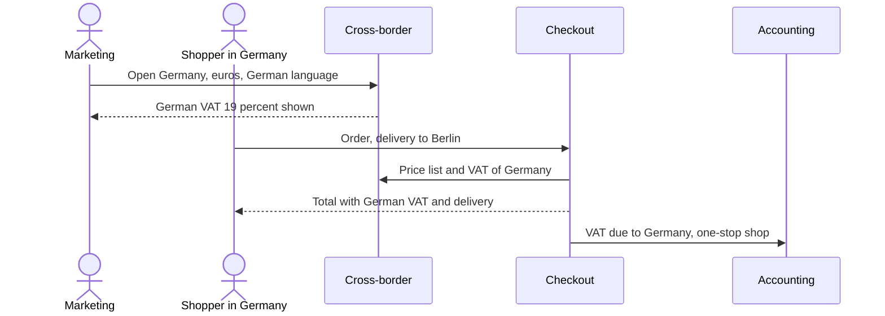

🏠 [Specs](../../../../README.md) › 🧩 [Functional capabilities](../../../README.md) ›
🛍️ [F11 Online shop (plugin)](../../README.md) › 📝 [Use cases](../README.md) › 📝 [Use cases: FL-F11-11](README.md) ›
📝 UC-F11-33 Sell across borders

# 📝 UC-F11-33 Sell across borders

**Status:** 🔄 waiting for the owner

## Summary

The shop opens countries one by one. For each country marketing sets the currency, the prices (the shop's price
converted, or its own), the shipping methods and costs, the payment methods and the language. The shopper sees prices in
their currency with the VAT of their country, and before paying sees the delivery cost and, outside the EU, the customs
duties they will owe. VAT on sales to consumers in other EU countries follows the one-stop-shop scheme.

## Personas

- [U12 Marketing and communication](../../../../01-users/personas/u12-marketing.md), who opens and prices the countries
- [U09 Customer](../../../../01-users/personas/u09-customer.md), the shopper abroad, on a phone

## Goal

A shopper anywhere in a served country sees the right price, VAT, delivery and duties, and the shop declares the right
VAT to the right country.

## Trigger

Marketing decides to sell to a new country, or a shopper from another country reaches the shop.

## Frequency

A few countries a year for marketing; every visit for the shopper.

## Preconditions

- The shop has several languages and currencies
  ([UC-F11-16](../01-build-the-shop/uc-f11-16-manage-seo-languages-and-several-websites.md)).
- Delivery methods serve the country ([E-F11-07 Delivery method](../../data/e-f11-07-delivery-method.md)).
- The shop's VAT setup knows the rates of the countries
  ([E-F8-33 Tax rate](../../../f08-accounting/data/e-f08-33-tax-rate.md)).

## Postconditions

- **Succeeded:** the country is open with its price list; orders from it carry its VAT and delivery, and the VAT is
  declared per country ([E-F11-27 Country price list](../../data/e-f11-27-country-price-list.md)).
- **Failed:** the shopper is told the country is not served and no order is taken.

## Main flow

1. Marketing opens Cross-border
   ([S-F11-32](../../screens/11-donations-gift-cards-and-cross-border/s-f11-32-cross-border.md)) and adds a country with
   its currency and language.
2. Marketing sets the prices of the country: converted from the shop's price with a rounding rule, or fixed by product,
   and the shipping methods and payment methods available there.
3. The screen shows the VAT rate of the country and, outside the EU, whether duties are collected at checkout or by the
   carrier on delivery.
4. Marketing opens the country; the shopper from that country sees prices with VAT in their currency.
5. At checkout, the shopper's delivery country decides the VAT rate and the shipping options
   ([BR-F11-28](../../business-rules/br-f11-28-vat-follows-the-customers-country-under-oss.md)); duties are shown before
   payment.
6. The VAT per country is totalled for the period and goes to the tax return
   ([E-F8-06 Tax return](../../../f08-accounting/data/e-f08-06-tax-return.md)).

## Alternative flows

- 2a. A product cannot be sold in a country (a restriction): it is hidden there, with the reason.
- 4a. A country is paused for a strike or a stock-out: shoppers see that it is paused and their carts are kept.
- 5a. A business buyer enters a valid VAT number: the sale follows the business rules
  ([UC-F11-11](../04-special-sales/uc-f11-11-sell-b2b-online.md)).

## Error flows

- 5e. The shopper's country is not served: checkout says so with the countries served
  ([BR-F11-28](../../business-rules/br-f11-28-vat-follows-the-customers-country-under-oss.md)).
- 2e. A product has no price in the currency: it cannot be sold there until priced.
- 3e. The VAT rate of the country is missing: the country cannot be opened.
- Any step: a service does not answer; the call is retried first
  ([BR-F3-32](../../../f03-assistant/business-rules/br-f03-32-retry-before-an-error.md)), then the message follows the
  error pattern ([D122](../../../../06-decisions/ux/d122-error-message-standard.md)) and the country stays closed and no
  order is taken from it.

## Business rules

- [BR-F11-28 VAT follows the customer's country under OSS](../../business-rules/br-f11-28-vat-follows-the-customers-country-under-oss.md)
- [BR-F11-04 Prices with taxes and delivery](../../business-rules/br-f11-04-prices-with-taxes-and-delivery.md)
- [BR-F11-01 The shop follows the country pack](../../business-rules/br-f11-01-shop-follows-the-country-pack.md)

## Entities

- [E-F11-27 Country price list](../../data/e-f11-27-country-price-list.md): created, opened, paused, retired
- [E-F11-03 Online product](../../data/e-f11-03-online-product.md): read
- [E-F11-07 Delivery method](../../data/e-f11-07-delivery-method.md): read
- [E-F8-33 Tax rate](../../../f08-accounting/data/e-f08-33-tax-rate.md): read
- [E-F8-06 Tax return](../../../f08-accounting/data/e-f08-06-tax-return.md): VAT per country fed to the return

## Permissions

Marketing opens and prices countries. The accountant reads the VAT per country. Shoppers see only the prices and
delivery of their country.

## Notifications

- Marketing, in the app: a shopper from a country not served, as a count.
- The accountant, in the app: the VAT per country ready for the return.

## Audit events

Country opened, paused and retired; each price list change; the VAT rate and the delivery country of every order.

## AI involvement

The AI assistant may draft prices and translations for a country, flagged as AI
([BR-F9-12](../../../f09-hr-and-projects/business-rules/br-f09-12-ai-calls-say-they-are-ai.md)); marketing reviews and
opens.

## API, MCP and A2A exposure

T5 operations on country price lists; no MCP tool and no A2A skill.

## Screens

- [S-F11-32 Cross-border](../../screens/11-donations-gift-cards-and-cross-border/s-f11-32-cross-border.md)

## Flowchart

See
[FL-F11-11 Donations, wishlists, gift cards and cross-border](../../flows/fl-f11-11-donations-gift-cards-and-cross-border.md#flowchart).

## Sequence diagram

## Acceptance criteria

1. **Given** Germany opened with its VAT **when** a shopper delivers to Berlin **then** the order carries German VAT.
2. **Given** a country not served **when** a shopper delivers there **then** checkout says it is not served.
3. **Given** a country paused **when** a shopper opens the shop **then** they see the pause and keep their cart.
4. **Given** a product without a price in the currency **when** marketing opens the country **then** it is not sold
   there.
5. **Given** sales to several countries **when** the period ends **then** the VAT is totalled per country.

## Non-functional notes

Prices and VAT of a country are applied in under 1 second at checkout.

## Regulatory references

VAT on distance sales in the EU follows
[CR-FR-071](../../../../10-country-packs/france/tax-and-vat/cr-fr-071-distance-sales-vat-oss.md). (Proposed) The
one-stop-shop declaration and the threshold below which the home VAT applies are written in the France pack with the
owner's confirmation, no article cited here; customs duties outside the EU depend on the destination and the carrier.

## Related use cases

- [UC-F11-03 Set online prices and promotions](../01-build-the-shop/uc-f11-03-set-online-prices-and-promotions.md)
- [UC-F11-07 Choose delivery or click & collect](../02-shop-and-check-out/uc-f11-07-choose-delivery-or-click-collect.md)
- [UC-F11-16 Manage SEO, languages and several websites](../01-build-the-shop/uc-f11-16-manage-seo-languages-and-several-websites.md)
- [UC-F11-11 Sell B2B online](../04-special-sales/uc-f11-11-sell-b2b-online.md)

## Open questions

None.

---

⬅️ [UC-F11-32 Sell and redeem gift cards online](uc-f11-32-sell-and-redeem-gift-cards-online.md) · ⬆️ [Up](README.md)
