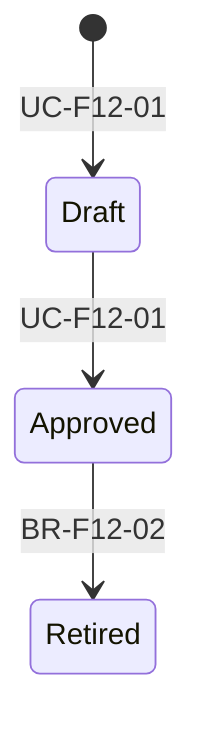

🏠 [Specs](../../../README.md) › 🧩 [Functional capabilities](../../README.md) ›
🏭 [F12 Manufacturing (plugin)](../README.md) › 🗃️ [Data](README.md) › 🗃️ E-F12-01 Bill of materials

# 🗃️ E-F12-01 Bill of materials

**Status:** ✅ specified

## Purpose

What a product is made of.

## Fields

| Name | Type | Required | Validation | Default | Example | Personal data | Custom fields |
|---|---|---|---|---|---|---|---|
| product, version | product, number | yes | unique pair | 1 | Kettle K2, v3 | no | yes |
| kind | manufacture, kit, subcontract | yes | - | manufacture | manufacture | no | no |
| lines | component, quantity, unit | yes | no loop | - | 1 x base | no | no |
| by-products | product, quantity | no | - | - | - | no | no |
| state | draft, approved, retired | yes | BR-F12-02 | draft | approved | no | no |

## Relations

As its use cases.

## Lifecycle

## Indexes and search

By number, date, partner.

## Retention

Kept for the period of its kind of record in the country pack (D293), or else its kind's default in the
[retention schedule](../../../05-non-functional/data-retention.md).

## Audit

Every change.

## Import and export

CSV, FEC where relevant.

## Used by

- [UC-F12-01](../use-cases/01-define-the-products/uc-f12-01-define-bills-of-materials.md)
- [UC-F12-10](../use-cases/01-define-the-products/uc-f12-10-manage-engineering-changes.md)

## Open questions

None.

---

⬆️ [Up](README.md) · ➡️ [E-F12-02 Work centre](e-f12-02-work-centre.md)
