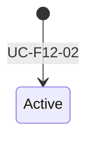

🏠 [Specs](../../../README.md) › 🧩 [Functional capabilities](../../README.md) ›
🏭 [F12 Manufacturing (plugin)](../README.md) › 🗃️ [Data](README.md) › 🗃️ E-F12-02 Work centre

# 🗃️ E-F12-02 Work centre

**Status:** ✅ specified

## Purpose

Where operations are done.

## Fields

| Name | Type | Required | Validation | Default | Example | Personal data | Custom fields |
|---|---|---|---|---|---|---|---|
| name, site | text, site | yes | unique per site | - | Press 2, Lyon | no | yes |
| capacity | units per hour, hours | yes | > 0 | - | 2 x 8 h | no | no |
| cost per hour | amount | yes | >= 0 | - | 48.00 EUR | no | no |
| equipment | list | no | - | - | P2-press | no | no |

## Relations

As its use cases.

## Lifecycle

## Indexes and search

By number, date, partner.

## Retention

Kept for the period of its kind of record in the country pack (D293), or else its kind's default in the
[retention schedule](../../../05-non-functional/data-retention.md).

## Audit

Every change.

## Import and export

CSV, FEC where relevant.

## Used by

- [UC-F12-02](../use-cases/01-define-the-products/uc-f12-02-define-work-centres-and-routings.md)
- [UC-F12-12](../use-cases/05-subcontracting-and-costs/uc-f12-12-cost-production.md)
- [UC-F12-14](../use-cases/06-machines-and-oee/uc-f12-14-connect-machines-and-sensors.md)

## Open questions

None.

---

⬅️ [E-F12-01 Bill of materials](e-f12-01-bill-of-materials.md) · ⬆️ [Up](README.md) ·
➡️ [E-F12-03 Routing operation](e-f12-03-routing-operation.md)
