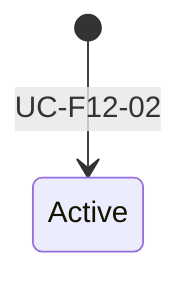

🏠 [Specs](../../../README.md) › 🧩 [Functional capabilities](../../README.md) ›
🏭 [F12 Manufacturing (plugin)](../README.md) › 🗃️ [Data](README.md) › 🗃️ E-F12-03 Routing operation

# 🗃️ E-F12-03 Routing operation

**Status:** ✅ specified

## Purpose

One step of a routing.

## Fields

| Name | Type | Required | Validation | Default | Example | Personal data | Custom fields |
|---|---|---|---|---|---|---|---|
| routing, sequence | routing, number | yes | - | - | R-K2, 20 | no | no |
| work centre | work centre | yes | - | - | Press 2 | no | no |
| time | minutes per unit | yes | >= 0 | - | 1.5 | no | no |
| instructions | text, files | no | - | - | K2-op20.pdf | no | no |
| checks | control points | no | - | - | diameter | no | no |

## Relations

As its use cases.

## Lifecycle

## Indexes and search

By number, date, partner.

## Retention

Kept for the period of its kind of record in the country pack (D293), or else its kind's default in the
[retention schedule](../../../05-non-functional/data-retention.md).

## Audit

Every change.

## Import and export

CSV, FEC where relevant.

## Used by

- [UC-F12-02](../use-cases/01-define-the-products/uc-f12-02-define-work-centres-and-routings.md)
- [UC-F12-28 Publish versioned work instructions](../use-cases/10-people-and-tools/uc-f12-28-publish-versioned-work-instructions.md)

## Open questions

None.

---

⬅️ [E-F12-02 Work centre](e-f12-02-work-centre.md) · ⬆️ [Up](README.md) ·
➡️ [E-F12-04 Manufacturing order](e-f12-04-manufacturing-order.md)
