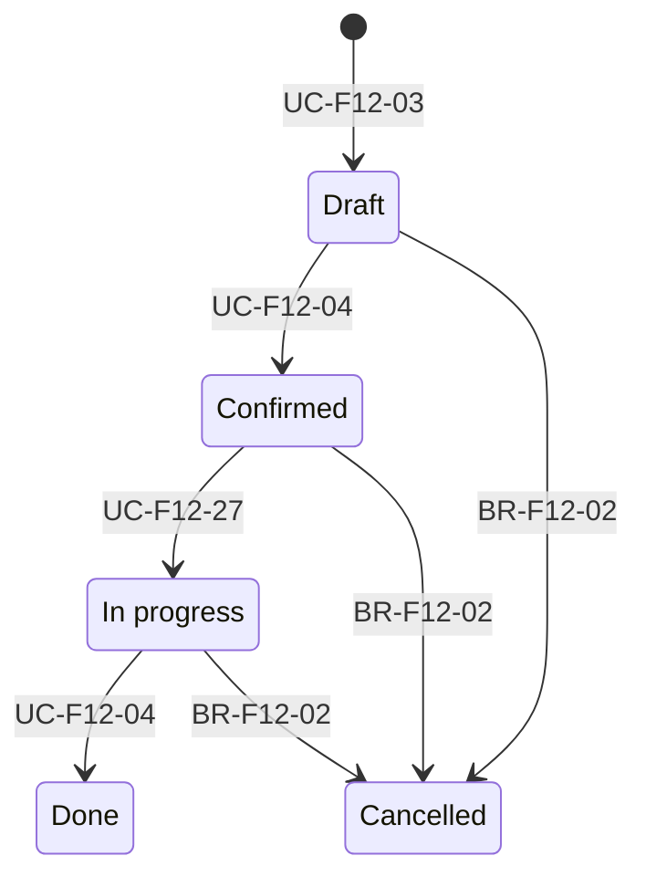

🏠 [Specs](../../../README.md) › 🧩 [Functional capabilities](../../README.md) ›
🏭 [F12 Manufacturing (plugin)](../README.md) › 🗃️ [Data](README.md) › 🗃️ E-F12-04 Manufacturing order

# 🗃️ E-F12-04 Manufacturing order

**Status:** ✅ specified

## Purpose

An order to make a quantity of a product.

## Fields

| Name | Type | Required | Validation | Default | Example | Personal data | Custom fields |
|---|---|---|---|---|---|---|---|
| reference | text | yes | unique | auto | MO-311 | no | no |
| product, quantity | product, number | yes | > 0 | - | Kettle K2, 500 | no | no |
| versions | BoM, routing | yes | BR-F12-02 | approved | v3 | no | no |
| kind | make, unbuild, repair, subcontract | yes | - | make | make | no | no |
| state | draft, confirmed, in progress, done, cancelled | yes | BR-F12-03 | draft | done | no | no |

## Relations

As its use cases.

## Lifecycle

## Indexes and search

By number, date, partner.

## Retention

As an accounting record:
[CR-FR-002 Accounting records kept 10 years](../../../10-country-packs/france/accounting/cr-fr-002-accounting-records-kept-ten-years.md);
lots per [CR-FR-061 Food traceability](../../../10-country-packs/france/products/cr-fr-061-food-traceability.md).

## Audit

Every change.

## Import and export

CSV, FEC where relevant.

## Used by

- [UC-F12-03](../use-cases/02-plan-production/uc-f12-03-plan-production.md)
- [UC-F12-04](../use-cases/03-make-the-products/uc-f12-04-launch-and-follow-manufacturing-orders.md)
- [UC-F12-09](../use-cases/05-subcontracting-and-costs/uc-f12-09-subcontract-manufacturing.md)
- [UC-F12-11](../use-cases/03-make-the-products/uc-f12-11-unbuild-rework-and-repair.md)
- [UC-F12-12](../use-cases/05-subcontracting-and-costs/uc-f12-12-cost-production.md)
- [UC-F12-19](../use-cases/08-report-and-assist/uc-f12-19-report-production.md)
- [UC-F12-20](../use-cases/08-report-and-assist/uc-f12-20-ask-the-assistant-about-production.md)
- [UC-F12-27 Value work in progress at month end](../use-cases/05-subcontracting-and-costs/uc-f12-27-value-work-in-progress-at-month-end.md)
- [UC-F12-31 Define a recipe and produce in batches](../use-cases/09-recipes-and-batches/uc-f12-31-define-a-recipe-and-produce-in-batches.md)

## Open questions

None.

---

⬅️ [E-F12-03 Routing operation](e-f12-03-routing-operation.md) · ⬆️ [Up](README.md) ·
➡️ [E-F12-05 Work order](e-f12-05-work-order.md)
