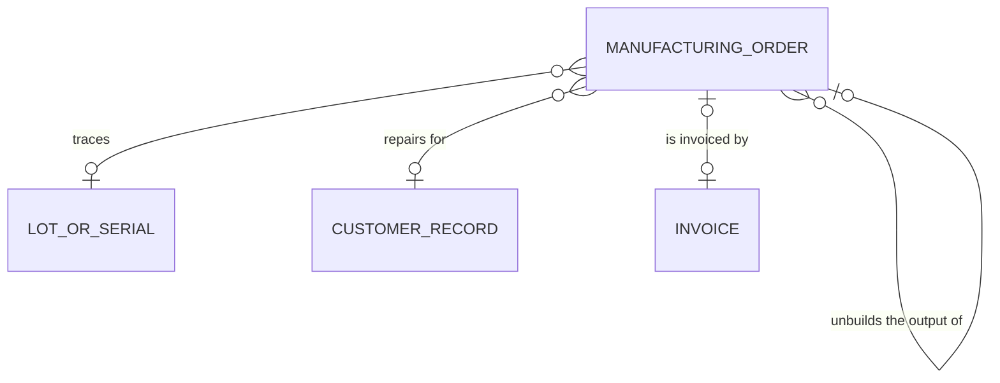
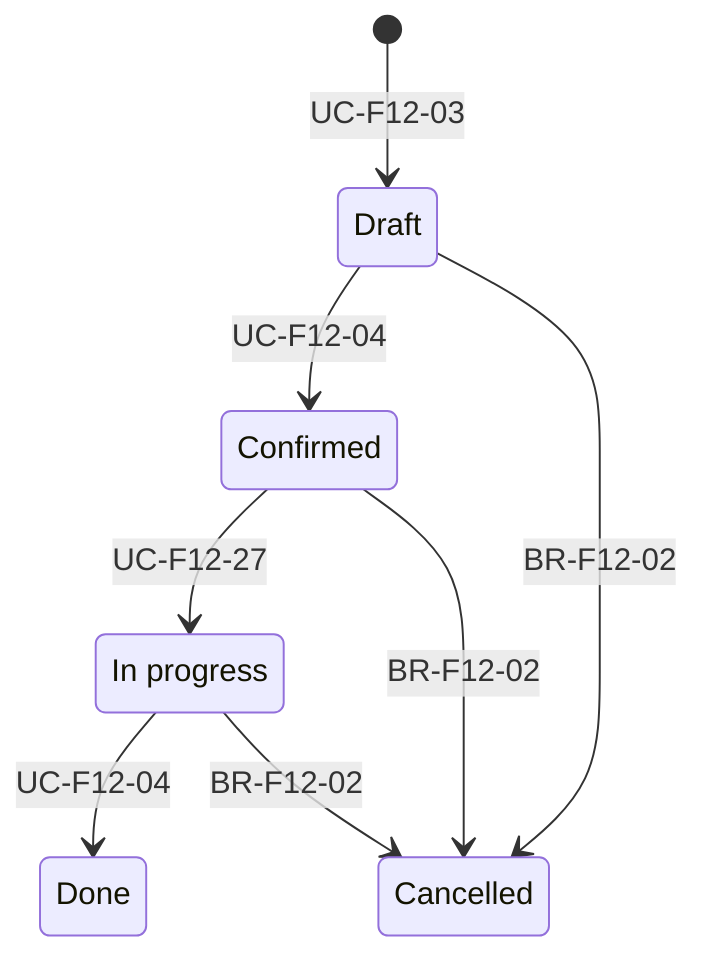

🏠 [Specs](../../../README.md) › 🧩 [Functional capabilities](../../README.md) ›
🏭 [F12 Manufacturing (plugin)](../README.md) › 🗃️ [Data](README.md) › 🗃️ E-F12-04 Manufacturing order

# 🗃️ E-F12-04 Manufacturing order

**Status:** ✅ specified

## Purpose

An order to make a quantity of a product or, of the kind unbuild, rework or repair, to take finished goods apart,
rework a defect or repair a customer's item
([UC-F12-11](../use-cases/03-make-the-products/uc-f12-11-unbuild-rework-and-repair.md)): the parts and the work are
recorded, the recovered parts return to stock with their lots
([BR-F12-04](../business-rules/br-f12-04-lots-traced-both-ways.md)), an unknown lot is asked, and a customer repair
closes with an invoice proposed (F6). The unbuild order the flow charts name "Unbuild" is this entity of the kind
unbuild, not a separate one ([E-F12-29](e-f12-29-unbuild-order.md), [D573](../../../06-decisions/foundations/d573-precedence-between-spec-pages.md)).

## Fields

| Name | Type | Required | Validation | Default | Example | Personal data | Custom fields |
|---|---|---|---|---|---|---|---|
| reference | text | yes | unique | auto | MO-311 | no | no |
| product, quantity | product, number | yes | > 0 | - | Kettle K2, 500 | no | no |
| versions | BoM, routing | yes | BR-F12-02 | approved | v3 | no | no |
| kind | make, unbuild, rework, repair, subcontract | yes | unbuild, rework and repair are opened by UC-F12-11 | make | make | no | no |
| source order | manufacturing order | no | the order whose output an unbuild takes apart | - | MO-310 | no | no |
| lot or serial | lot or serial | for unbuild, rework and repair | BR-F12-04; asked when unknown | - | B20-2611 | no | no |
| customer | customer record | for a customer repair | - | - | the kettle's owner | when a person | no |
| parts | lines: part, action, lot | for unbuild, rework and repair | each recovered part returns to stock with its lot, BR-F12-04 | - | Heating element, replace, H8-0091 | no | no |
| work | text | no | - | - | element changed, tested | no | no |
| under guarantee | yes, no | no | for a repair | - | yes | no | no |
| invoice | invoice | no | proposed when a customer repair closes | - | INV-2611 | no | no |
| state | draft, confirmed, in progress, done, cancelled | yes | BR-F12-03 | draft | done | no | no |

## Relations

As its use cases, and for the kinds unbuild, rework and repair:

- [E-F7-10 Lot or serial](../../f07-purchasing-and-stock/data/e-f07-10-lot-or-serial.md)
- [E-F6-01 Customer record](../../f06-customers-and-sales/data/e-f06-01-customer-record.md)
- [E-F6-05 Invoice](../../f06-customers-and-sales/data/e-f06-05-invoice.md)

## Lifecycle

An unbuild, rework or repair order follows the same states: confirmed when the planner opens it, done when the parts
are back in stock or the item is repaired (UC-F12-11).

## Indexes and search

By number, date, partner, kind, source order, lot or serial and customer.

## Retention

As an accounting record:
[CR-FR-002 Accounting records kept 10 years](../../../10-country-packs/france/accounting/cr-fr-002-accounting-records-kept-ten-years.md);
lots per [CR-FR-061 Food traceability](../../../10-country-packs/france/products/cr-fr-061-food-traceability.md).

## Audit

Every change.

## Import and export

CSV, FEC where relevant.

## Used by

- [UC-F12-03](../use-cases/02-plan-production/uc-f12-03-plan-production.md)
- [UC-F12-04](../use-cases/03-make-the-products/uc-f12-04-launch-and-follow-manufacturing-orders.md)
- [UC-F12-09](../use-cases/05-subcontracting-and-costs/uc-f12-09-subcontract-manufacturing.md)
- [UC-F12-11](../use-cases/03-make-the-products/uc-f12-11-unbuild-rework-and-repair.md)
- [UC-F12-12](../use-cases/05-subcontracting-and-costs/uc-f12-12-cost-production.md)
- [UC-F12-19](../use-cases/08-report-and-assist/uc-f12-19-report-production.md)
- [UC-F12-20](../use-cases/08-report-and-assist/uc-f12-20-ask-the-assistant-about-production.md)
- [UC-F12-27 Value work in progress at month end](../use-cases/05-subcontracting-and-costs/uc-f12-27-value-work-in-progress-at-month-end.md)
- [UC-F12-31 Define a recipe and produce in batches](../use-cases/09-recipes-and-batches/uc-f12-31-define-a-recipe-and-produce-in-batches.md)

## Open questions

None.

---

⬅️ [E-F12-03 Routing operation](e-f12-03-routing-operation.md) · ⬆️ [Up](README.md) ·
➡️ [E-F12-05 Work order](e-f12-05-work-order.md)
