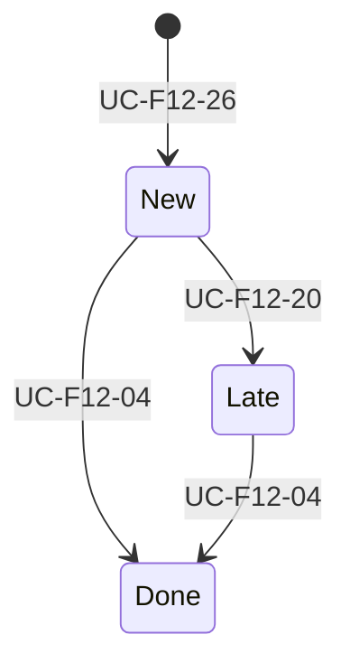

🏠 [Specs](../../../README.md) › 🧩 [Functional capabilities](../../README.md) ›
🏭 [F12 Manufacturing (plugin)](../README.md) › 🗃️ [Data](README.md) › 🗃️ E-F12-05 Work order

# 🗃️ E-F12-05 Work order

**Status:** ✅ specified

## Purpose

One operation of a manufacturing order, as worked.

## Fields

| Name | Type | Required | Validation | Default | Example | Personal data | Custom fields |
|---|---|---|---|---|---|---|---|
| order, operation | records | yes | - | - | MO-311, op 20 | no | no |
| operator | person | yes | BR-F12-07 | - | P. N. | yes | no |
| quantities | good, scrap | yes | >= 0 | 0 | 480, 6 | no | no |
| times | start, end, pauses | yes | - | - | 08:02 to 11:40 | no | no |
| source | manual, machine | yes | BR-F12-08 | manual | machine | no | no |

## Relations

As its use cases.

## Lifecycle

## Indexes and search

By number, date, partner.

## Retention

As an accounting record:
[CR-FR-002 Accounting records kept 10 years](../../../10-country-packs/france/accounting/cr-fr-002-accounting-records-kept-ten-years.md);
lots per [CR-FR-061 Food traceability](../../../10-country-packs/france/products/cr-fr-061-food-traceability.md).

## Audit

Every change.

## Import and export

CSV, FEC where relevant.

## Used by

- [UC-F12-04](../use-cases/03-make-the-products/uc-f12-04-launch-and-follow-manufacturing-orders.md)
- [UC-F12-05](../use-cases/03-make-the-products/uc-f12-05-work-on-the-shop-floor-tablet.md)
- [UC-F12-20](../use-cases/08-report-and-assist/uc-f12-20-ask-the-assistant-about-production.md)
- [UC-F12-23 Schedule with finite capacity](../use-cases/11-finite-schedule-and-the-tablet/uc-f12-23-schedule-with-finite-capacity.md)
- [UC-F12-26 Keep working on the tablet without the network](../use-cases/11-finite-schedule-and-the-tablet/uc-f12-26-keep-working-on-the-tablet-without-the-network.md)

## Open questions

None.

---

⬅️ [E-F12-04 Manufacturing order](e-f12-04-manufacturing-order.md) · ⬆️ [Up](README.md) ·
➡️ [E-F12-06 Component consumption](e-f12-06-component-consumption.md)
