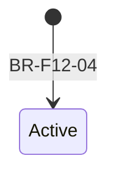

🏠 [Specs](../../../README.md) › 🧩 [Functional capabilities](../../README.md) ›
🏭 [F12 Manufacturing (plugin)](../README.md) › 🗃️ [Data](README.md) › 🗃️ E-F12-06 Component consumption

# 🗃️ E-F12-06 Component consumption

**Status:** ✅ specified

## Purpose

A lot or serial consumed by an order.

## Fields

| Name | Type | Required | Validation | Default | Example | Personal data | Custom fields |
|---|---|---|---|---|---|---|---|
| order | order | yes | - | - | MO-311 | no | no |
| component, lot | product, lot | yes | BR-F12-04 | - | Base B1, L-77 | no | no |
| quantity | number | yes | stock >= 0 (BR-F12-05) | - | 500 | no | no |
| finished lot | lot | yes | - | - | K2-2611 | no | no |

## Relations

As its use cases.

## Lifecycle

## Indexes and search

By number, date, partner.

## Retention

As an accounting record:
[CR-FR-002 Accounting records kept 10 years](../../../10-country-packs/france/accounting/cr-fr-002-accounting-records-kept-ten-years.md);
lots per [CR-FR-061 Food traceability](../../../10-country-packs/france/products/cr-fr-061-food-traceability.md).

## Audit

Every change.

## Import and export

CSV, FEC where relevant.

## Used by

- [UC-F12-06](../use-cases/03-make-the-products/uc-f12-06-consume-components-trace-lots-and-serials.md)
- [UC-F12-15](../use-cases/02-plan-production/uc-f12-15-pick-and-stage-components.md)
- [UC-F12-26 Keep working on the tablet without the network](../use-cases/11-finite-schedule-and-the-tablet/uc-f12-26-keep-working-on-the-tablet-without-the-network.md)

## Open questions

None.

---

⬅️ [E-F12-05 Work order](e-f12-05-work-order.md) · ⬆️ [Up](README.md) ·
➡️ [E-F12-07 Quality control point](e-f12-07-quality-control-point.md)
