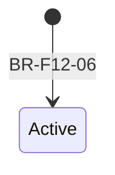

🏠 [Specs](../../../README.md) › 🧩 [Functional capabilities](../../README.md) ›
🏭 [F12 Manufacturing (plugin)](../README.md) › 🗃️ [Data](README.md) › 🗃️ E-F12-07 Quality control point

# 🗃️ E-F12-07 Quality control point

**Status:** ✅ specified

## Purpose

A check to run at an operation.

## Fields

| Name | Type | Required | Validation | Default | Example | Personal data | Custom fields |
|---|---|---|---|---|---|---|---|
| operation | routing operation | yes | - | - | op 20 | no | no |
| kind | pass-fail, measure, photo, instructions | yes | - | pass-fail | measure | no | no |
| tolerance | min, max | no | - | - | 24.9 to 25.1 mm | no | no |
| mandatory | yes, no | yes | BR-F12-06 | yes | yes | no | no |

## Relations

As its use cases.

## Lifecycle

## Indexes and search

By number, date, partner.

## Retention

Kept for the period of its kind of record in the country pack (D293), or else its kind's default in the
[retention schedule](../../../05-non-functional/data-retention.md).

## Audit

Every change.

## Import and export

CSV, FEC where relevant.

## Used by

- [UC-F12-07](../use-cases/04-quality-and-maintenance/uc-f12-07-run-quality-checks-and-handle-non-conformities.md)
- [UC-F12-25 Monitor a process with control charts](../use-cases/12-quality-engineering/uc-f12-25-monitor-a-process-with-control-charts.md)

## Open questions

None.

---

⬅️ [E-F12-06 Component consumption](e-f12-06-component-consumption.md) · ⬆️ [Up](README.md) ·
➡️ [E-F12-08 Non-conformity](e-f12-08-non-conformity.md)
