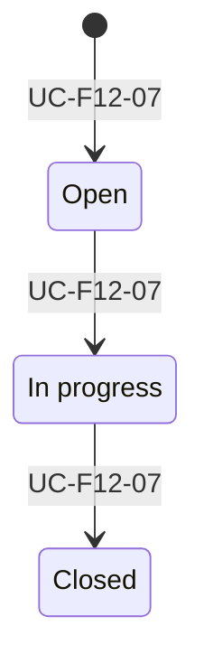

🏠 [Specs](../../../README.md) › 🧩 [Functional capabilities](../../README.md) ›
🏭 [F12 Manufacturing (plugin)](../README.md) › 🗃️ [Data](README.md) › 🗃️ E-F12-08 Non-conformity

# 🗃️ E-F12-08 Non-conformity

**Status:** ✅ specified

## Purpose

A defect found and its handling.

## Fields

| Name | Type | Required | Validation | Default | Example | Personal data | Custom fields |
|---|---|---|---|---|---|---|---|
| reference | text | yes | unique | auto | NC-88 | no | no |
| order, lot | records | yes | - | - | MO-311, K2-2611 | no | no |
| cause, action | text | no | - | - | worn tool, replace | no | no |
| state | open, in progress, closed | yes | - | open | closed | no | no |

## Relations

As its use cases.

## Lifecycle

## Indexes and search

By number, date, partner.

## Retention

Kept for the period of its kind of record in the country pack (D293), or else its kind's default in the
[retention schedule](../../../05-non-functional/data-retention.md).

## Audit

Every change.

## Import and export

CSV, FEC where relevant.

## Used by

- [UC-F12-07](../use-cases/04-quality-and-maintenance/uc-f12-07-run-quality-checks-and-handle-non-conformities.md)

## Open questions

None.

---

⬅️ [E-F12-07 Quality control point](e-f12-07-quality-control-point.md) · ⬆️ [Up](README.md) ·
➡️ [E-F12-09 Equipment](e-f12-09-equipment.md)
