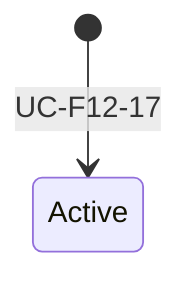

🏠 [Specs](../../../README.md) › 🧩 [Functional capabilities](../../README.md) ›
🏭 [F12 Manufacturing (plugin)](../README.md) › 🗃️ [Data](README.md) › 🗃️ E-F12-09 Equipment

# 🗃️ E-F12-09 Equipment

**Status:** ✅ specified

## Purpose

A machine or tool, with its checks.

## Fields

| Name | Type | Required | Validation | Default | Example | Personal data | Custom fields |
|---|---|---|---|---|---|---|---|
| name, serial | text | yes | unique serial | - | Press P2, 4471 | no | yes |
| work centre | work centre | no | - | - | Press 2 | no | no |
| periodic check | period, next date | no | BR-F12-09 | - | 12 months, 2027-03-01 | no | no |
| compliance | declaration, manual | no | - | - | CE 2019 | no | no |

## Relations

As its use cases.

## Lifecycle

## Indexes and search

By number, date, partner.

## Retention

Kept for the period of its kind of record in the country pack (D293), or else its kind's default in the
[retention schedule](../../../05-non-functional/data-retention.md).

## Audit

Every change.

## Import and export

CSV, FEC where relevant.

## Used by

- [UC-F12-08](../use-cases/04-quality-and-maintenance/uc-f12-08-maintain-equipment.md)
- [UC-F12-17](../use-cases/07-compliance-and-safety/uc-f12-17-keep-the-risk-assessment-and-safety-registers.md)
- [UC-F12-21 Calibrate measuring equipment](../use-cases/10-people-and-tools/uc-f12-21-calibrate-measuring-equipment.md)

## Open questions

None.

---

⬅️ [E-F12-08 Non-conformity](e-f12-08-non-conformity.md) · ⬆️ [Up](README.md) ·
➡️ [E-F12-10 Maintenance request](e-f12-10-maintenance-request.md)
