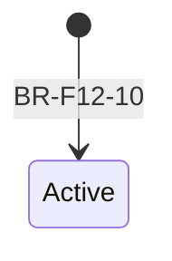

🏠 [Specs](../../../README.md) › 🧩 [Functional capabilities](../../README.md) ›
🏭 [F12 Manufacturing (plugin)](../README.md) › 🗃️ [Data](README.md) › 🗃️ E-F12-10 Maintenance request

# 🗃️ E-F12-10 Maintenance request

**Status:** ✅ specified

## Purpose

Preventive or corrective work on equipment.

## Fields

| Name | Type | Required | Validation | Default | Example | Personal data | Custom fields |
|---|---|---|---|---|---|---|---|
| equipment | equipment | yes | - | - | Press P2 | no | no |
| kind | preventive, corrective, legal check | yes | - | corrective | preventive | no | no |
| planned, done | dates | no | BR-F12-10 | - | 2026-11-14 | no | no |
| result | text, files | no | - | - | ok, report.pdf | no | no |

## Relations

As its use cases.

## Lifecycle

## Indexes and search

By number, date, partner.

## Retention

Kept for the period of its kind of record in the country pack (D293), or else its kind's default in the
[retention schedule](../../../05-non-functional/data-retention.md).

## Audit

Every change.

## Import and export

CSV, FEC where relevant.

## Used by

- [UC-F12-08](../use-cases/04-quality-and-maintenance/uc-f12-08-maintain-equipment.md)

## Open questions

None.

---

⬅️ [E-F12-09 Equipment](e-f12-09-equipment.md) · ⬆️ [Up](README.md) ·
➡️ [E-F12-11 Engineering change](e-f12-11-engineering-change.md)
