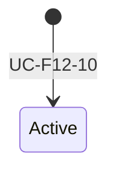

🏠 [Specs](../../../README.md) › 🧩 [Functional capabilities](../../README.md) ›
🏭 [F12 Manufacturing (plugin)](../README.md) › 🗃️ [Data](README.md) › 🗃️ E-F12-11 Engineering change

# 🗃️ E-F12-11 Engineering change

**Status:** ✅ specified

## Purpose

A reviewed change to a product, BoM or routing.

## Fields

| Name | Type | Required | Validation | Default | Example | Personal data | Custom fields |
|---|---|---|---|---|---|---|---|
| reference | text | yes | unique | auto | ECO-19 | no | no |
| object | product, BoM, routing | yes | - | - | BoM Kettle K2 | no | no |
| versions | from, to | yes | BR-F12-02 | - | v3 to v4 | no | no |
| approvals | people, dates | yes | - | - | 2 of 2 | no | no |

## Relations

As its use cases.

## Lifecycle

## Indexes and search

By number, date, partner.

## Retention

Kept for the period of its kind of record in the country pack (D293), or else its kind's default in the
[retention schedule](../../../05-non-functional/data-retention.md).

## Audit

Every change.

## Import and export

CSV, FEC where relevant.

## Used by

- [UC-F12-10](../use-cases/01-define-the-products/uc-f12-10-manage-engineering-changes.md)

## Open questions

None.

---

⬅️ [E-F12-10 Maintenance request](e-f12-10-maintenance-request.md) · ⬆️ [Up](README.md) ·
➡️ [E-F12-12 Master plan line](e-f12-12-master-plan-line.md)
