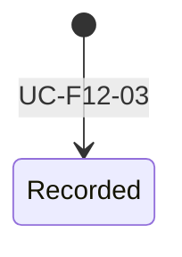

🏠 [Specs](../../../README.md) › 🧩 [Functional capabilities](../../README.md) ›
🏭 [F12 Manufacturing (plugin)](../README.md) › 🗃️ [Data](README.md) › 🗃️ E-F12-12 Master plan line

# 🗃️ E-F12-12 Master plan line

**Status:** ✅ specified

## Purpose

Planned production of a product per period.

## Fields

| Name | Type | Required | Validation | Default | Example | Personal data | Custom fields |
|---|---|---|---|---|---|---|---|
| product, period | product, week | yes | unique pair | - | Kettle K2, W47 | no | no |
| forecast, planned | numbers | yes | >= 0 | 0 | 600, 500 | no | no |
| proposals | orders | no | - | - | MO-311 | no | no |

## Relations

As its use cases.

## Lifecycle

## Indexes and search

By number, date, partner.

## Retention

Kept for the period of its kind of record in the country pack (D293), or else its kind's default in the
[retention schedule](../../../05-non-functional/data-retention.md).

## Audit

Every change.

## Import and export

CSV, FEC where relevant.

## Used by

- [UC-F12-03](../use-cases/02-plan-production/uc-f12-03-plan-production.md)

## Open questions

None.

---

⬅️ [E-F12-11 Engineering change](e-f12-11-engineering-change.md) · ⬆️ [Up](README.md) ·
➡️ [E-F12-13 Machine signal](e-f12-13-machine-signal.md)
