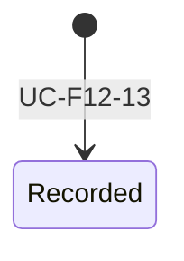

🏠 [Specs](../../../README.md) › 🧩 [Functional capabilities](../../README.md) ›
🏭 [F12 Manufacturing (plugin)](../README.md) › 🗃️ [Data](README.md) › 🗃️ E-F12-13 Machine signal

# 🗃️ E-F12-13 Machine signal

**Status:** ✅ specified

## Purpose

A count, time or stop from a machine.

## Fields

| Name | Type | Required | Validation | Default | Example | Personal data | Custom fields |
|---|---|---|---|---|---|---|---|
| work centre | work centre | yes | - | - | Press 2 | no | no |
| kind | count, cycle, stop, start | yes | - | - | stop | no | no |
| value, reason | number, text | no | - | - | 4 min, jam | no | no |
| time, source | time, connector | yes | BR-F12-08 | - | 10:12, PLC-2 | no | no |

## Relations

As its use cases.

## Lifecycle

## Indexes and search

By number, date, partner.

## Retention

Raw signals 13 months, aggregates as long as the reports need them.

## Audit

Every change.

## Import and export

CSV, FEC where relevant.

## Used by

- [UC-F12-13](../use-cases/06-machines-and-oee/uc-f12-13-measure-oee-and-downtime.md)
- [UC-F12-14](../use-cases/06-machines-and-oee/uc-f12-14-connect-machines-and-sensors.md)
- [UC-F12-19](../use-cases/08-report-and-assist/uc-f12-19-report-production.md)
- [UC-F12-29 Measure energy per operation](../use-cases/13-energy-passport-and-work-in-progress/uc-f12-29-measure-energy-per-operation.md)

## Open questions

None.

---

⬅️ [E-F12-12 Master plan line](e-f12-12-master-plan-line.md) · ⬆️ [Up](README.md) ·
➡️ [E-F12-14 Product compliance file](e-f12-14-product-compliance-file.md)
