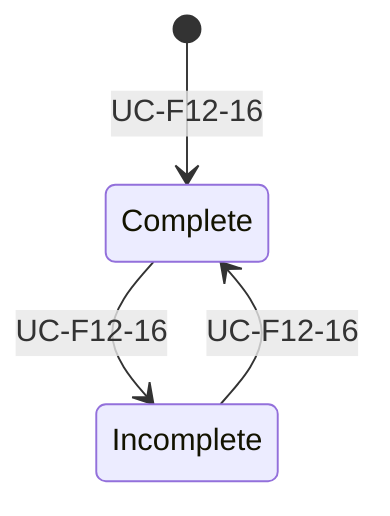

🏠 [Specs](../../../README.md) › 🧩 [Functional capabilities](../../README.md) ›
🏭 [F12 Manufacturing (plugin)](../README.md) › 🗃️ [Data](README.md) › 🗃️ E-F12-14 Product compliance file

# 🗃️ E-F12-14 Product compliance file

**Status:** ✅ specified

## Purpose

The compliance documents of a product.

## Fields

| Name | Type | Required | Validation | Default | Example | Personal data | Custom fields |
|---|---|---|---|---|---|---|---|
| product | product | yes | - | - | Press kit PK1 | no | no |
| documents | declaration, technical file, manual | no | BR-F12-13 | - | declaration.pdf | no | no |
| substances | list over 0.1 % | no | - | - | lead | no | no |
| notifications | references | no | - | - | SCIP ref | no | no |
| state | incomplete, complete | yes | - | incomplete | complete | no | no |

## Relations

As its use cases.

## Lifecycle

## Indexes and search

By number, date, partner.

## Retention

While the product is sold and after, per
[CR-FR-074 Conformity of machinery](../../../10-country-packs/france/products/cr-fr-074-machinery-conformity.md).

## Audit

Every change.

## Import and export

CSV, FEC where relevant.

## Used by

- [UC-F12-16](../use-cases/07-compliance-and-safety/uc-f12-16-record-product-compliance.md)
- [UC-F12-30 Build the digital product passport](../use-cases/13-energy-passport-and-work-in-progress/uc-f12-30-build-the-digital-product-passport.md)

## Open questions

None.

---

⬅️ [E-F12-13 Machine signal](e-f12-13-machine-signal.md) · ⬆️ [Up](README.md) ·
➡️ [E-F12-15 Waste register line](e-f12-15-waste-register-line.md)
