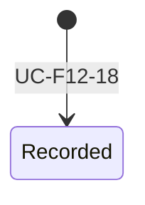

🏠 [Specs](../../../README.md) › 🧩 [Functional capabilities](../../README.md) ›
🏭 [F12 Manufacturing (plugin)](../README.md) › 🗃️ [Data](README.md) › 🗃️ E-F12-15 Waste register line

# 🗃️ E-F12-15 Waste register line

**Status:** ✅ specified

## Purpose

A waste leaving a site.

## Fields

| Name | Type | Required | Validation | Default | Example | Personal data | Custom fields |
|---|---|---|---|---|---|---|---|
| date, site | date, site | yes | - | - | 2026-11-11, Lyon | no | no |
| waste code, quantity | code, kg | yes | BR-F12-14 | - | 12 01 01, 30 | no | no |
| carrier, destination, treatment | records | yes | - | - | Recycla, R4 | no | no |

## Relations

As its use cases.

## Lifecycle

## Indexes and search

By number, date, partner.

## Retention

Per [CR-FR-079 Waste register](../../../10-country-packs/france/environment/cr-fr-079-waste-register.md).

## Audit

Every change.

## Import and export

CSV, FEC where relevant.

## Used by

- [UC-F12-18](../use-cases/07-compliance-and-safety/uc-f12-18-track-waste-and-environmental-records.md)

## Open questions

None.

---

⬅️ [E-F12-14 Product compliance file](e-f12-14-product-compliance-file.md) · ⬆️ [Up](README.md) ·
➡️ [E-F12-16 Calibration](e-f12-16-calibration.md)
