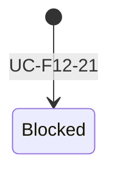

🏠 [Specs](../../../README.md) › 🧩 [Functional capabilities](../../README.md) ›
🏭 [F12 Manufacturing (plugin)](../README.md) › 🗃️ [Data](README.md) › 🗃️ E-F12-16 Calibration

# 🗃️ E-F12-16 Calibration

**Status:** 🔄 waiting for the owner

## Purpose

A measuring instrument's calibration interval, results and certificates.

## Fields

| Name | Type | Required | Validation | Default | Example | Personal data | Custom fields |
|---|---|---|---|---|---|---|---|
| instrument | equipment | yes | - | - | Caliper C-12 | no | - |
| interval | months | yes | - | - | 6 | no | - |
| result | within, out of tolerance | yes | - | - | within | no | - |
| certificate | file | no | - | - | cert-c12-2611.pdf | no | - |
| next due | date | yes | - | - | 2027-05-15 | no | - |

## Relations

On Equipment (E-F12-09); checks refer to it.

## Lifecycle

Current, due, blocked.

## Indexes and search

By due date.

## Retention

10 years (Proposed).

## Audit

Results and blocks.

## Import and export

None.

## Used by

- [UC-F12-21 Calibrate measuring equipment](../use-cases/10-people-and-tools/uc-f12-21-calibrate-measuring-equipment.md)

## Open questions

None.

---

⬅️ [E-F12-15 Waste register line](e-f12-15-waste-register-line.md) · ⬆️ [Up](README.md) ·
➡️ [E-F12-17 Qualification requirement](e-f12-17-qualification-requirement.md)
