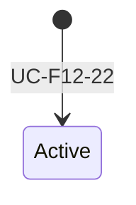

🏠 [Specs](../../../README.md) › 🧩 [Functional capabilities](../../README.md) ›
🏭 [F12 Manufacturing (plugin)](../README.md) › 🗃️ [Data](README.md) › 🗃️ E-F12-17 Qualification requirement

# 🗃️ E-F12-17 Qualification requirement

**Status:** ✅ specified

## Purpose

The qualifications a work centre requires.

## Fields

| Name | Type | Required | Validation | Default | Example | Personal data | Custom fields |
|---|---|---|---|---|---|---|---|
| work centre | work centre | yes | - | - | Press P2 | no | - |
| qualifications | list | yes | exist in F9 | - | press safety | no | - |

## Relations

Between Work centres and Qualifications (E-F9-12).

## Lifecycle

Changed.

## Indexes and search

By centre.

## Retention

While the centre exists.

## Audit

Changes and refusals.

## Import and export

None.

## Used by

- [UC-F12-22 Require operator qualifications per work centre](../use-cases/10-people-and-tools/uc-f12-22-require-operator-qualifications-per-work-centre.md)

## Open questions

None.

---

⬅️ [E-F12-16 Calibration](e-f12-16-calibration.md) · ⬆️ [Up](README.md) ·
➡️ [E-F12-18 Schedule slot](e-f12-18-schedule-slot.md)
