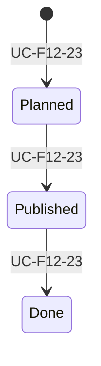

🏠 [Specs](../../../README.md) › 🧩 [Functional capabilities](../../README.md) ›
🏭 [F12 Manufacturing (plugin)](../README.md) › 🗃️ [Data](README.md) › 🗃️ E-F12-18 Schedule slot

# 🗃️ E-F12-18 Schedule slot

**Status:** ✅ specified

## Purpose

An operation placed on a work centre at a time.

## Fields

| Name | Type | Required | Validation | Default | Example | Personal data | Custom fields |
|---|---|---|---|---|---|---|---|
| work order | work order | yes | - | - | MO-412 op 20 | no | - |
| work centre | work centre | yes | within capacity | - | Press P3 | no | - |
| start, end | date and time | yes | within calendar | - | 12-08 06:00-12:00 | no | - |
| late by | days | no | - | - | 0 | no | - |

## Relations

One per scheduled operation.

## Lifecycle

Planned, published, done.

## Indexes and search

By centre and day.

## Retention

As the order.

## Audit

Published schedules.

## Import and export

None.

## Used by

- [UC-F12-23 Schedule with finite capacity](../use-cases/11-finite-schedule-and-the-tablet/uc-f12-23-schedule-with-finite-capacity.md)

## Open questions

None.

---

⬅️ [E-F12-17 Qualification requirement](e-f12-17-qualification-requirement.md) · ⬆️ [Up](README.md) ·
➡️ [E-F12-19 FMEA line](e-f12-19-fmea-line.md)
