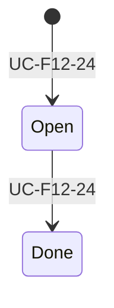

🏠 [Specs](../../../README.md) › 🧩 [Functional capabilities](../../README.md) ›
🏭 [F12 Manufacturing (plugin)](../README.md) › 🗃️ [Data](README.md) › 🗃️ E-F12-19 FMEA line

# 🗃️ E-F12-19 FMEA line

**Status:** 🔄 waiting for the owner

## Purpose

A failure mode with its ratings and actions.

## Fields

| Name | Type | Required | Validation | Default | Example | Personal data | Custom fields |
|---|---|---|---|---|---|---|---|
| product or step | reference | yes | - | - | B-20 welding | no | - |
| mode, effect, cause | text | yes | - | - | crack, breakage, heat | no | - |
| S, O, D | 1 to 10 | yes | - | - | 8, 4, 5 | no | - |
| priority | S x O x D | yes | - | - | 160 | no | - |
| action | owner, date, status | no | - | - | weld inspection, 12-20 | no | - |

## Relations

On a Bill of materials or Routing operation.

## Lifecycle

Open, action done, re-rated.

## Indexes and search

By priority.

## Retention

Product life + 10 years (Proposed).

## Audit

Ratings and actions.

## Import and export

None.

## Used by

- [UC-F12-24 Run an FMEA](../use-cases/12-quality-engineering/uc-f12-24-run-an-fmea.md)

## Open questions

None.

---

⬅️ [E-F12-18 Schedule slot](e-f12-18-schedule-slot.md) · ⬆️ [Up](README.md) ·
➡️ [E-F12-20 Control chart](e-f12-20-control-chart.md)
