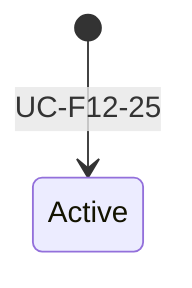

🏠 [Specs](../../../README.md) › 🧩 [Functional capabilities](../../README.md) ›
🏭 [F12 Manufacturing (plugin)](../README.md) › 🗃️ [Data](README.md) › 🗃️ E-F12-20 Control chart

# 🗃️ E-F12-20 Control chart

**Status:** ✅ specified

## Purpose

A control point's measures, limits and signals.

## Fields

| Name | Type | Required | Validation | Default | Example | Personal data | Custom fields |
|---|---|---|---|---|---|---|---|
| control point | quality control point | yes | - | - | Diameter op 30 | no | - |
| limits | lower, mean, upper | no | enough measures | - | 11.94, 12.00, 12.06 | no | - |
| signals | list with cause | no | - | - | 12.08, worn tool | no | - |

## Relations

Reads Quality checks of its control point (E-F12-07).

## Lifecycle

Limits recomputed on change.

## Indexes and search

By control point.

## Retention

As quality records.

## Audit

Signals and causes.

## Import and export

None.

## Used by

- [UC-F12-25 Monitor a process with control charts](../use-cases/12-quality-engineering/uc-f12-25-monitor-a-process-with-control-charts.md)

## Open questions

None.

---

⬅️ [E-F12-19 FMEA line](e-f12-19-fmea-line.md) · ⬆️ [Up](README.md) ·
➡️ [E-F12-21 Work-in-progress valuation](e-f12-21-work-in-progress-valuation.md)
