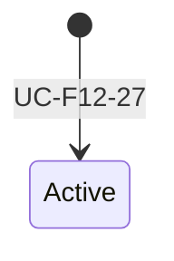

🏠 [Specs](../../../README.md) › 🧩 [Functional capabilities](../../README.md) ›
🏭 [F12 Manufacturing (plugin)](../README.md) › 🗃️ [Data](README.md) › 🗃️ E-F12-21 Work-in-progress valuation

# 🗃️ E-F12-21 Work-in-progress valuation

**Status:** ✅ specified

## Purpose

The month-end value of open orders.

## Fields

| Name | Type | Required | Validation | Default | Example | Personal data | Custom fields |
|---|---|---|---|---|---|---|---|
| date | month end | yes | - | - | 2026-11-30 | no | - |
| orders | list with values | yes | - | - | 14 orders | no | - |
| total | amount | yes | - | - | 38,400 EUR | no | - |
| entry | journal entry | no | - | - | WIP 11-30 | no | - |

## Relations

Values Manufacturing orders; posts to F8.

## Lifecycle

Computed, posted, reversed.

## Indexes and search

By month.

## Retention

10 years.

## Audit

Posted.

## Import and export

None.

## Used by

- [UC-F12-27 Value work in progress at month end](../use-cases/05-subcontracting-and-costs/uc-f12-27-value-work-in-progress-at-month-end.md)

## Open questions

None.

---

⬅️ [E-F12-20 Control chart](e-f12-20-control-chart.md) · ⬆️ [Up](README.md) ·
➡️ [E-F12-22 Work instruction version](e-f12-22-work-instruction-version.md)
