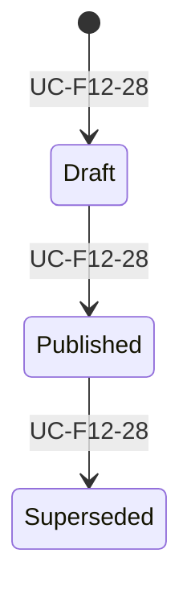

🏠 [Specs](../../../README.md) › 🧩 [Functional capabilities](../../README.md) ›
🏭 [F12 Manufacturing (plugin)](../README.md) › 🗃️ [Data](README.md) › 🗃️ E-F12-22 Work instruction version

# 🗃️ E-F12-22 Work instruction version

**Status:** 🔄 waiting for the owner

## Purpose

An operation's instruction version and its acknowledgements.

## Fields

| Name | Type | Required | Validation | Default | Example | Personal data | Custom fields |
|---|---|---|---|---|---|---|---|
| operation | routing operation | yes | - | - | Op 20 | no | - |
| version | number, date | yes | - | - | v4, 2026-11-10 | no | - |
| content | text, images, video | yes | - | - | torque 24 Nm | no | - |
| acknowledged by | operators with time | no | - | - | Paul 11-11 06:02 | yes | - |

## Relations

On a Routing operation (E-F12-03).

## Lifecycle

Draft, published, superseded.

## Indexes and search

By operation.

## Retention

As the product (Proposed).

## Audit

Versions and acknowledgements.

## Import and export

None.

## Used by

- [UC-F12-28 Publish versioned work instructions](../use-cases/10-people-and-tools/uc-f12-28-publish-versioned-work-instructions.md)

## Open questions

None.

---

⬅️ [E-F12-21 Work-in-progress valuation](e-f12-21-work-in-progress-valuation.md) · ⬆️ [Up](README.md) ·
➡️ [E-F12-23 Energy reading](e-f12-23-energy-reading.md)
