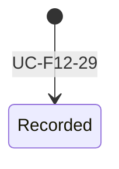

🏠 [Specs](../../../README.md) › 🧩 [Functional capabilities](../../README.md) ›
🏭 [F12 Manufacturing (plugin)](../README.md) › 🗃️ [Data](README.md) › 🗃️ E-F12-23 Energy reading

# 🗃️ E-F12-23 Energy reading

**Status:** 🔄 waiting for the owner

## Purpose

Energy used by a work centre in a period and its allocation.

## Fields

| Name | Type | Required | Validation | Default | Example | Personal data | Custom fields |
|---|---|---|---|---|---|---|---|
| work centre | work centre | yes | - | - | Press P2 | no | - |
| period | date | yes | - | - | 2026-12-08 | no | - |
| energy | kWh | yes | - | - | 412 | no | - |
| method | meter, estimated | yes | - | - | meter | no | - |

## Relations

Allocated to Work orders.

## Lifecycle

Read, allocated.

## Indexes and search

By centre and period.

## Retention

5 years (Proposed).

## Audit

Allocations.

## Import and export

None.

## Used by

- [UC-F12-29 Measure energy per operation](../use-cases/13-energy-passport-and-work-in-progress/uc-f12-29-measure-energy-per-operation.md)

## Open questions

None.

---

⬅️ [E-F12-22 Work instruction version](e-f12-22-work-instruction-version.md) · ⬆️ [Up](README.md) ·
➡️ [E-F12-24 Product passport](e-f12-24-product-passport.md)
