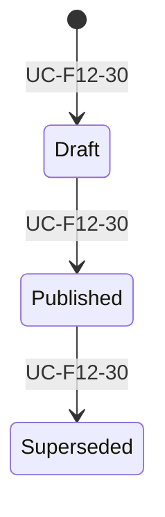

🏠 [Specs](../../../README.md) › 🧩 [Functional capabilities](../../README.md) ›
🏭 [F12 Manufacturing (plugin)](../README.md) › 🗃️ [Data](README.md) › 🗃️ E-F12-24 Product passport

# 🗃️ E-F12-24 Product passport

**Status:** ✅ specified, ⚖️ lawyer review before launch (D574)

## Purpose

A product's digital passport with its fields and sources.

## Fields

| Name | Type | Required | Validation | Default | Example | Personal data | Custom fields |
|---|---|---|---|---|---|---|---|
| product | item | yes | - | - | Bracket B-20 | no | - |
| fields | name, value, source | yes | required ones complete | - | steel 98 %, BOM | no | - |
| identifier | QR code | yes | - | - | B20-v2 | no | - |
| version | number | yes | - | - | v2 | no | - |

## Relations

Reads the Compliance file (E-F12-14), the BOM and energy.

## Lifecycle

Draft, published, superseded.

## Indexes and search

By product.

## Retention

As the law sets (⚖️ lawyer review before launch, D574) to read: Regulation (EU) 2024/1781 (ESPR) and the delegated act of each
product group, which set how long a passport stays available.

## Audit

Versions.

## Import and export

None.

## Used by

- [UC-F12-30 Build the digital product passport](../use-cases/13-energy-passport-and-work-in-progress/uc-f12-30-build-the-digital-product-passport.md)

## Open questions

None.

---

⬅️ [E-F12-23 Energy reading](e-f12-23-energy-reading.md) · ⬆️ [Up](README.md) ·
➡️ [E-F12-25 Recipe](e-f12-25-recipe.md)
