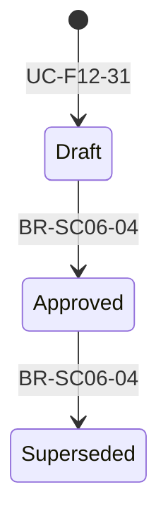

🏠 [Specs](../../../README.md) › 🧩 [Functional capabilities](../../README.md) ›
🏭 [F12 Manufacturing (plugin)](../README.md) › 🗃️ [Data](README.md) › 🗃️ E-F12-25 Recipe

# 🗃️ E-F12-25 Recipe

**Status:** ✅ specified

## Purpose

Ingredients with tolerances, steps, yield, allergens and best-before, for batch production.

## Fields

| Name | Type | Required | Validation | Default | Example | Personal data | Custom fields |
|---|---|---|---|---|---|---|---|
| product | item | yes | - | - | Tomme | no | - |
| reference quantity | quantity | yes | - | - | 100 L of milk | no | - |
| ingredients | item, quantity, tolerance | yes | - | - | rennet 25 ml +-2 % | no | - |
| steps | text, time, temperature | yes | - | - | curdle 40 min at 32 C | no | - |
| yield, allergens, best-before | quantity, list, days | yes | - | - | 10 kg, milk, 120 days | no | - |

### Sector extension: SC06 Hospitality

From [E-SC06-01 Recipe](../../../08-sectors/sc06-hospitality/data/e-sc06-01-recipe.md), merged here
([D517](../../../06-decisions/foundations/d517-the-drafts-open-points-answered-on-2026-11-13.md), S0). A dish's recipe
on the shared recipes capability ([E-F12-25 Recipe](../../../02-functional/f12-manufacturing/data/e-f12-25-recipe.md));
the restaurant adds its cost per portion from the latest purchase prices.

| Name | Type | Required | Validation | Default | Example | Personal data | Custom fields |
|---|---|---|---|---|---|---|---|
| dish, version | records | yes | - | 1 | Pesto pasta, v2 | no | no |
| ingredients, yield | list, percent | yes | BR-SC06-04 | - | basil 80 g | no | no |
| cost | amount | no | - | - | 3.40 | no | no |

## Relations

Batches are Manufacturing orders (E-F12-04) using it; lots traced.

## Lifecycle

Draft, approved, superseded.

## Indexes and search

By product.

## Retention

As the product.

## Audit

Versions.

## Import and export

None.

## Used by

- [UC-F12-31 Define a recipe and produce in batches](../use-cases/09-recipes-and-batches/uc-f12-31-define-a-recipe-and-produce-in-batches.md)
- [UC-SC06-01 Cost recipes and build menus](../../../08-sectors/sc06-hospitality/use-cases/01-menus-and-food-safety/uc-sc06-01-cost-recipes-and-build-menus.md)

## Open questions

None.

---

⬅️ [E-F12-24 Product passport](e-f12-24-product-passport.md) · ⬆️ [Up](README.md) ·
➡️ [E-F12-26 Risk assessment](e-f12-26-risk-assessment.md)
