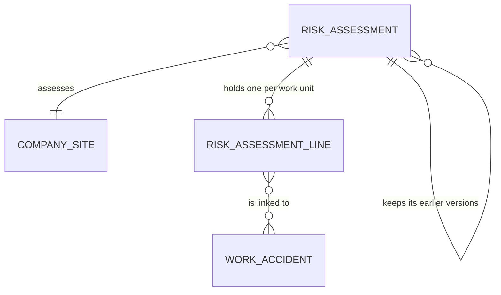
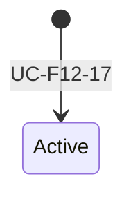

🏠 [Specs](../../../README.md) › 🧩 [Functional capabilities](../../README.md) ›
🏭 [F12 Manufacturing (plugin)](../README.md) › 🗃️ [Data](README.md) › 🗃️ E-F12-26 Risk assessment

# 🗃️ E-F12-26 Risk assessment

**Status:** ✅ specified

## Purpose

The risk assessment the flow charts name with the words "Risk assessment"
([FL-F12-07](../flows/fl-f12-07-compliance-and-safety.md)). The owner decided to create it
([D516](../../../06-decisions/foundations/d516-naming-rules-and-the-seven-classes-of-names.md)); its fields are derived
from the specifications and confirmed by the owner (D572).

## Fields

| Name | Type | Required | Validation | Default | Example | Personal data | Custom fields |
|---|---|---|---|---|---|---|---|
| title | text | yes | one document for the company, BR-F12-15 | - | Occupational risk assessment | no | no |
| site | company site | no | the site of a work unit, set on each line | - | Lyon workshop | no | no |
| version | number | yes | above 0; a new version keeps the old one, BR-F12-15 | 1 | 7 | no | no |
| version date | date | yes | - | - | 2026-11-03 | no | no |
| work units | risk assessment lines: work unit, its site, main risks, actions | yes | one line per work unit, BR-F12-15 | - | Press 2: crushing, noise; two-hand control, ear protection | no | no |
| next update due | date | no | the yearly update and the update after an accident, CR-FR-076 | - | 2027-11-03 | no | no |
| state | active | yes | the lifecycle below | active | active | no | no |

The company's single risk assessment document, one line per work unit, the plant's work units included, shared with
the occupational risk assessment of F9
([UC-F12-17](../use-cases/07-compliance-and-safety/uc-f12-17-keep-the-risk-assessment-and-safety-registers.md),
[UC-F9-27](../../f09-hr-and-projects/use-cases/09-train-and-protect/uc-f09-27-keep-the-occupational-risk-assessment.md)).
Every version is kept ([BR-F12-15](../business-rules/br-f12-15-risk-assessment-versions-kept.md)); the yearly reminder
and the version due come from UC-F12-17. The title and the state are the columns of
[S-F12-L26 Risk assessments](../screens/00-lists/s-f12-l26-risk-assessments.md); the site, the version, the work units
with their main risks and actions, and the kept versions are what
[S-F12-17 Safety registers](../screens/07-compliance-and-safety/s-f12-17-safety-registers.md) shows.

## Relations

- [E-F1-02 Company site](../../f01-administration/data/e-f01-02-company-site.md)
- [E-F9-24 Risk assessment line](../../f09-hr-and-projects/data/e-f09-24-risk-assessment-line.md)
- [E-F9-23 Work accident](../../f09-hr-and-projects/data/e-f09-23-work-accident.md)
- [E-F12-27 Safety register](e-f12-27-safety-register.md), kept on the same screen

## Lifecycle

A new version is a new record in the state Active; the earlier version is kept read-only (BR-F12-15).

## Indexes and search

By title, site, version and state; the assessments whose next update is due.

## Retention

As the other records of its capability.

## Audit

Every change, as the other records of its capability.

## Import and export

CSV or XLSX export of the fields the user may see; PDF export of the assessment for an inspector (UC-F12-17); no
import.

## Used by

- [UC-F12-17 Keep the risk assessment and safety registers](../use-cases/07-compliance-and-safety/uc-f12-17-keep-the-risk-assessment-and-safety-registers.md)

## Open questions

None.

---

⬅️ [E-F12-25 Recipe](e-f12-25-recipe.md) · ⬆️ [Up](README.md) ·
➡️ [E-F12-27 Safety register](e-f12-27-safety-register.md)
