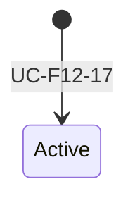

🏠 [Specs](../../../README.md) › 🧩 [Functional capabilities](../../README.md) ›
🏭 [F12 Manufacturing (plugin)](../README.md) › 🗃️ [Data](README.md) › 🗃️ E-F12-27 Safety register

# 🗃️ E-F12-27 Safety register

**Status:** 🔄 waiting for the owner

## Purpose

(Proposed) The safety register the flow charts name with the words "Safety register"
([FL-F12-07](../flows/fl-f12-07-compliance-and-safety.md)). The owner decided to create it
([D516](../../../06-decisions/foundations/d516-naming-rules-and-the-seven-classes-of-names.md)); what it holds waits for
the owner's confirmation.

## Fields

(Proposed) To define with the owner: the flow charts name the record, not its fields.

## Relations

(Proposed) To define with the owner, from the use cases below.

## Lifecycle

## Indexes and search

(Proposed) To define with the owner.

## Retention

(Proposed) As the other records of its capability, to confirm with the owner.

## Audit

(Proposed) Every change, as the other records of its capability.

## Import and export

(Proposed) To define with the owner.

## Used by

- [UC-F12-17 Keep the risk assessment and safety registers](../use-cases/07-compliance-and-safety/uc-f12-17-keep-the-risk-assessment-and-safety-registers.md)

## Open questions

(Proposed) Its fields, relations and states wait for the owner (waiting list, step 36e).

---

⬅️ [E-F12-26 Risk assessment](e-f12-26-risk-assessment.md) · ⬆️ [Up](README.md) ·
➡️ [E-F12-28 Shop-floor terminal](e-f12-28-shop-floor-terminal.md)
