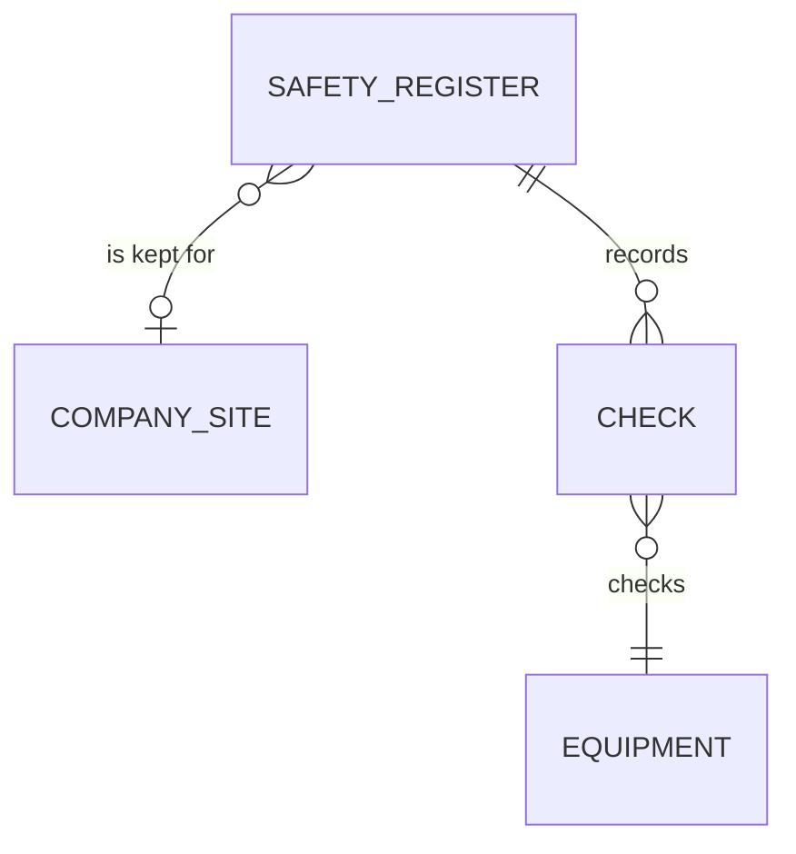
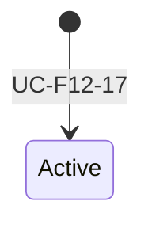

🏠 [Specs](../../../README.md) › 🧩 [Functional capabilities](../../README.md) ›
🏭 [F12 Manufacturing (plugin)](../README.md) › 🗃️ [Data](README.md) › 🗃️ E-F12-27 Safety register

# 🗃️ E-F12-27 Safety register

**Status:** ✅ specified

## Purpose

The safety register the flow charts name with the words "Safety register"
([FL-F12-07](../flows/fl-f12-07-compliance-and-safety.md)). The owner decided to create it
([D516](../../../06-decisions/foundations/d516-naming-rules-and-the-seven-classes-of-names.md)); its fields are derived
from the specifications and confirmed by the owner (D572).

## Fields

| Name | Type | Required | Validation | Default | Example | Personal data | Custom fields |
|---|---|---|---|---|---|---|---|
| title | text | yes | - | - | Machine checks register | no | no |
| site | company site | no | - | - | Lyon workshop | no | no |
| checks | lines, one per check | no | - | - | 14 checks in 2026 | no | no |
| check: equipment | equipment | yes | BR-F12-09 | - | Press P2 | no | no |
| check: date | date | yes | - | - | 2026-11-12 | no | no |
| check: checked by | person or body | yes | a qualified person, CR-FR-075 | - | external inspector | when a person | no |
| check: result | text | yes | - | - | compliant | no | no |
| check: report | file | no | - | - | report-p2.pdf | no | no |
| state | active | yes | the lifecycle below | active | active | no | no |

The register of the equipment checks
([UC-F12-17](../use-cases/07-compliance-and-safety/uc-f12-17-keep-the-risk-assessment-and-safety-registers.md)): each
check is written in it with its result, and an external check's report is attached
([CR-FR-075](../../../10-country-packs/france/labour/cr-fr-075-work-equipment-periodic-checks.md)). The period and the
next date of each check stay on the equipment, and an overdue check is flagged
([BR-F12-09](../business-rules/br-f12-09-equipment-checks-before-use.md)). The title and the state are the columns of
[S-F12-L27 Safety registers](../screens/00-lists/s-f12-l27-safety-registers.md); the checks of the year are what
[S-F12-17 Safety registers](../screens/07-compliance-and-safety/s-f12-17-safety-registers.md) shows.

## Relations

- [E-F1-02 Company site](../../f01-administration/data/e-f01-02-company-site.md)
- [E-F12-09 Equipment](e-f12-09-equipment.md)
- [E-F12-26 Risk assessment](e-f12-26-risk-assessment.md), kept on the same screen

## Lifecycle

A recorded check is read-only and is corrected by a new check (S-F12-17).

## Indexes and search

By title, site and state; the checks by equipment and date.

## Retention

As the other records of its capability.

## Audit

Every change, as the other records of its capability.

## Import and export

CSV or XLSX export of the fields the user may see; PDF export of the register for an inspector (UC-F12-17); no import.

## Used by

- [UC-F12-17 Keep the risk assessment and safety registers](../use-cases/07-compliance-and-safety/uc-f12-17-keep-the-risk-assessment-and-safety-registers.md)

## Open questions

None.

---

⬅️ [E-F12-26 Risk assessment](e-f12-26-risk-assessment.md) · ⬆️ [Up](README.md) ·
➡️ [E-F12-28 Shop-floor terminal](e-f12-28-shop-floor-terminal.md)
