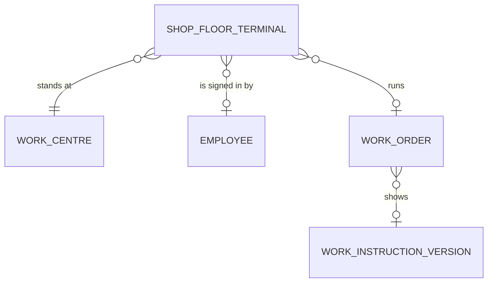
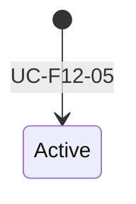

🏠 [Specs](../../../README.md) › 🧩 [Functional capabilities](../../README.md) ›
🏭 [F12 Manufacturing (plugin)](../README.md) › 🗃️ [Data](README.md) › 🗃️ E-F12-28 Shop-floor terminal

# 🗃️ E-F12-28 Shop-floor terminal

**Status:** ✅ specified

## Purpose

The shop-floor terminal the flow charts name with the words "Shop-floor tablet"
([FL-F12-03](../flows/fl-f12-03-make-the-products.md)). The owner decided to create it
([D516](../../../06-decisions/foundations/d516-naming-rules-and-the-seven-classes-of-names.md)); its fields are derived
from the specifications and confirmed by the owner (D572).

## Fields

| Name | Type | Required | Validation | Default | Example | Personal data | Custom fields |
|---|---|---|---|---|---|---|---|
| name | text | yes | - | - | Terminal Press 2 | no | no |
| work centre | work centre | yes | - | - | Press 2 | no | no |
| signed-in operator | employee | no | badge or PIN, qualified for the work centre, BR-F12-07 | - | P. N. | yes | no |
| current operation | work order | no | - | - | MO-311 op 10 Cut and press | no | no |
| shift loaded at | date and time | no | - | - | 2026-11-27 06:00 | no | no |
| connection | online, offline | yes | - | online | offline | no | no |
| records waiting | number | yes | 0 or above; sent in order, BR-F12-21 | 0 | 3 | no | no |
| state | active | yes | the lifecycle below | active | active | no | no |

The tablet of a work centre, where the operator signs in with a badge or PIN and works under their own name
([UC-F12-05](../use-cases/03-make-the-products/uc-f12-05-work-on-the-shop-floor-tablet.md),
[BR-F12-07](../business-rules/br-f12-07-operators-sign-in-at-the-work-centre.md)). At the shift's start it loads the
work centre's work orders, instructions and checks; offline, it shows the number of records waiting and sends them in
order when the network is back
([UC-F12-26](../use-cases/11-finite-schedule-and-the-tablet/uc-f12-26-keep-working-on-the-tablet-without-the-network.md),
[BR-F12-21](../business-rules/br-f12-21-tablet-records-sync-in-order.md)). The quantities, scrap and checks the operator
records are written on the work order, not on the terminal. The name and the state are the columns of
[S-F12-L28 Shop-floor terminals](../screens/00-lists/s-f12-l28-shop-floor-terminals.md); the work centre, the operator
and the current operation are what
[S-F12-05 Shop-floor tablet](../screens/03-make-the-products/s-f12-05-shop-floor-tablet.md) shows.

## Relations

- [E-F12-02 Work centre](e-f12-02-work-centre.md)
- [E-F12-05 Work order](e-f12-05-work-order.md)
- [E-F12-22 Work instruction version](e-f12-22-work-instruction-version.md)
- [E-F9-01 Employee record](../../f09-hr-and-projects/data/e-f09-01-employee-record.md)

## Lifecycle

## Indexes and search

By name, work centre, connection and state; the terminals offline with records waiting.

## Retention

As the other records of its capability.

## Audit

Every change, as the other records of its capability.

## Import and export

CSV or XLSX export of the fields the user may see; no import.

## Used by

- [UC-F12-05 Work on the shop-floor tablet](../use-cases/03-make-the-products/uc-f12-05-work-on-the-shop-floor-tablet.md)

## Open questions

None.

---

⬅️ [E-F12-27 Safety register](e-f12-27-safety-register.md) · ⬆️ [Up](README.md) ·
➡️ [E-F12-29 Unbuild order](e-f12-29-unbuild-order.md)
