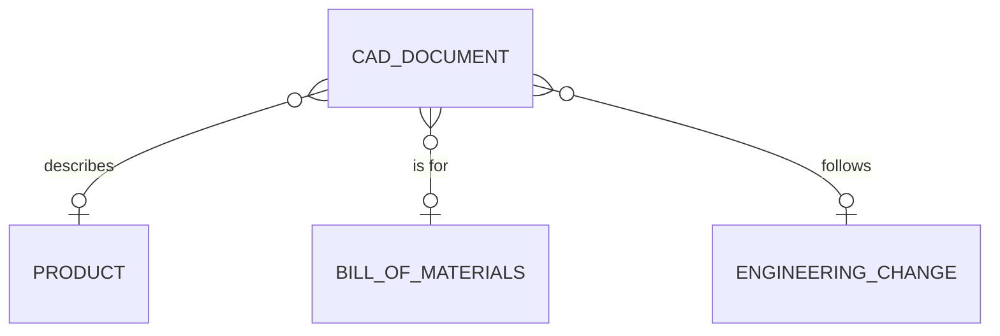
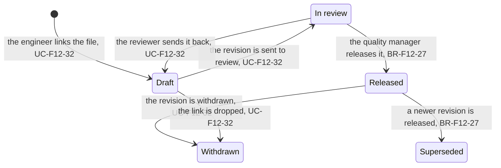

🏠 [Specs](../../../README.md) › 🧩 [Functional capabilities](../../README.md) ›
🏭 [F12 Manufacturing (plugin)](../README.md) › 🗃️ [Data](README.md) › 🗃️ E-F12-30 CAD document

# 🗃️ E-F12-30 CAD document

**Status:** ✅ specified

## Purpose

A drawing, model or specification kept in the file store, linked by reference and revision to a product, a bill of
materials or a routing step ([D531](../../../06-decisions/f12-manufacturing/d531-benchmark-gaps-f12-manufacturing.md)).

## Fields

| Name | Type | Required | Validation | Default | Example | Personal data | Custom fields |
|---|---|---|---|---|---|---|---|
| reference | text | yes | unique with the revision | - | K2-017 | no | no |
| revision | text | yes | - | A | C | no | no |
| file link | address in the store | yes | - | - | store/K2/K2-017-C.step | no | no |
| format | step, pdf, dwg, other | yes | - | - | step | no | no |
| linked to | product, bill of materials or routing step | yes | at least 1 | - | Kettle K2 | no | no |
| released by, at | user, date | when released | quality manager | - | Marc D., 2026-11-18 | yes | no |
| change reason | engineering change | no | - | - | ECO-19 | no | no |
| state | draft, in review, released, superseded, withdrawn | yes | the lifecycle below | draft | draft | no | no |

## Relations

- [E-F12-01 Bill of materials](e-f12-01-bill-of-materials.md)
- [E-F12-03 Routing operation](e-f12-03-routing-operation.md)
- [E-F12-11 Engineering change](e-f12-11-engineering-change.md)
- [E-F12-22 Work instruction version](e-f12-22-work-instruction-version.md)

## Lifecycle

## Indexes and search

By reference, revision, linked object and state; the revisions waiting for review.

## Retention

Kept with the product's technical file as long as the product is made and 10 years after.

## Audit

Every link, review, release, supersession and withdrawal, with who and the orders affected.

## Import and export

CSV import of links from the store's index; CSV export of the revisions in force.

## Used by

- [UC-F12-32 Link CAD files and revisions](../use-cases/14-cad-kanban-mps-and-tools/uc-f12-32-link-cad-files-and-revisions.md)

## Open questions

None.

---

⬅️ [E-F12-29 Unbuild order](e-f12-29-unbuild-order.md) · ⬆️ [Up](README.md) ·
➡️ [E-F12-31 Kanban card](e-f12-31-kanban-card.md)
