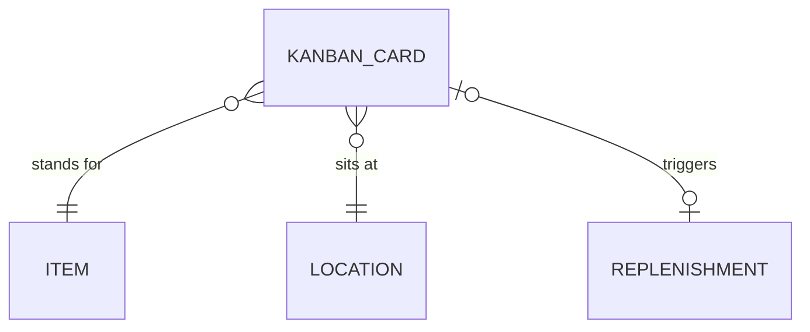
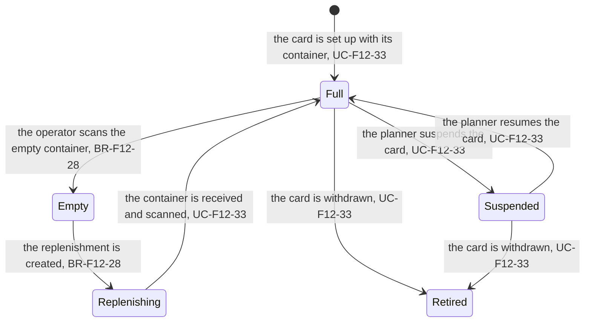

🏠 [Specs](../../../README.md) › 🧩 [Functional capabilities](../../README.md) ›
🏭 [F12 Manufacturing (plugin)](../README.md) › 🗃️ [Data](README.md) › 🗃️ E-F12-31 Kanban card

# 🗃️ E-F12-31 Kanban card

**Status:** ✅ specified

## Purpose

A card for one container of an item at a point of use, which triggers its replenishment
([D531](../../../06-decisions/f12-manufacturing/d531-benchmark-gaps-f12-manufacturing.md)).

## Fields

| Name | Type | Required | Validation | Default | Example | Personal data | Custom fields |
|---|---|---|---|---|---|---|---|
| number | text | yes | unique | auto | 12 | no | no |
| item | item | yes | - | - | Screw M4 | no | no |
| location | location | yes | - | - | Line 2, bin 3 | no | no |
| container size | number | yes | above 0 | - | 2000 | no | no |
| source | production order, purchase request, transfer | yes | - | - | purchase request | no | no |
| last replenishment | reference | no | - | - | PR-2204 | no | no |
| emptied at | date and time | when empty | - | - | 2026-11-18 09:10 | no | no |
| state | full, empty, replenishing, suspended, retired | yes | the lifecycle below | full | full | no | no |

## Relations

- [E-F7-06 Item](../../f07-purchasing-and-stock/data/e-f07-06-item.md)
- [E-F7-07 Location](../../f07-purchasing-and-stock/data/e-f07-07-location.md)
- [E-F7-09 Reordering rule](../../f07-purchasing-and-stock/data/e-f07-09-reordering-rule.md)
- [E-F12-04 Manufacturing order](e-f12-04-manufacturing-order.md)

## Lifecycle

## Indexes and search

By number, item, location and state; the cards waiting longest.

## Retention

Kept while the card is in use, then 1 year after retirement.

## Audit

Every scan and state change with the station, the operator and the replenishment created.

## Import and export

CSV import of cards at set-up; CSV export of the cards and their waiting times.

## Used by

- [UC-F12-33 Replenish with kanban cards](../use-cases/14-cad-kanban-mps-and-tools/uc-f12-33-replenish-with-kanban-cards.md)

## Open questions

None.

---

⬅️ [E-F12-30 CAD document](e-f12-30-cad-document.md) · ⬆️ [Up](README.md) ·
➡️ [E-F12-32 MPS line](e-f12-32-mps-line.md)
