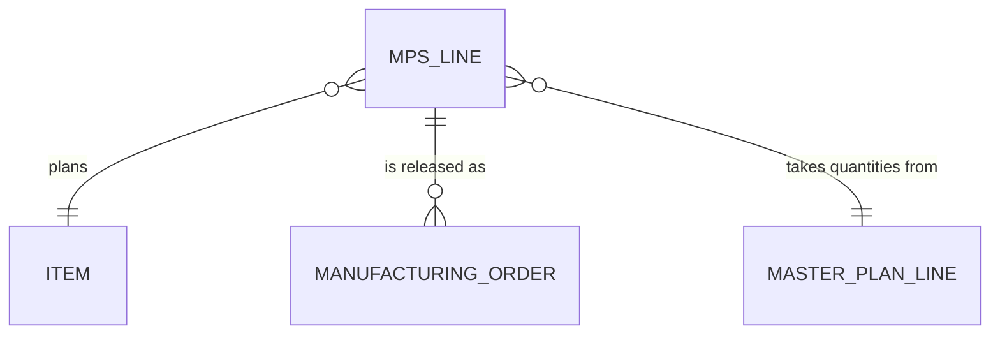
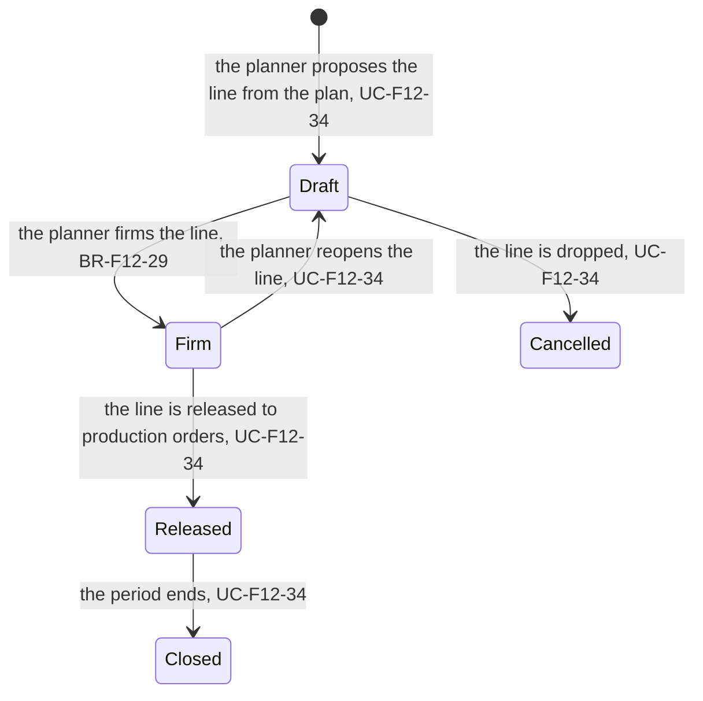

🏠 [Specs](../../../README.md) › 🧩 [Functional capabilities](../../README.md) ›
🏭 [F12 Manufacturing (plugin)](../README.md) › 🗃️ [Data](README.md) › 🗃️ E-F12-32 MPS line

# 🗃️ E-F12-32 MPS line

**Status:** ✅ specified

## Purpose

A product's planned production in one week of the master production schedule, firmed against capacity and released as
production orders ([D531](../../../06-decisions/f12-manufacturing/d531-benchmark-gaps-f12-manufacturing.md)). It takes
its quantities from the plan line of the same product and period
([E-F12-12 Master plan line](e-f12-12-master-plan-line.md)).

## Fields

| Name | Type | Required | Validation | Default | Example | Personal data | Custom fields |
|---|---|---|---|---|---|---|---|
| product | item | yes | - | - | Kettle K2 | no | no |
| week | week | yes | unique pair with the product | - | 2026-W48 | no | no |
| forecast | number | yes | >= 0 | 0 | 600 | no | no |
| firm orders | number | yes | >= 0 | 0 | 420 | no | no |
| planned production | number | yes | >= 0 | from the plan line | 500 | no | no |
| available to promise | number | yes | computed | - | 80 | no | no |
| load | hours | yes | computed from the routing | - | 94 | no | no |
| note on over capacity | text | when over capacity | - | - | Overtime agreed | no | no |
| state | draft, firm, released, closed, cancelled | yes | the lifecycle below | draft | draft | no | no |

## Relations

- [E-F12-12 Master plan line](e-f12-12-master-plan-line.md)
- [E-F12-02 Work centre](e-f12-02-work-centre.md)
- [E-F12-04 Manufacturing order](e-f12-04-manufacturing-order.md)
- [E-F7-21 Demand forecast](../../f07-purchasing-and-stock/data/e-f07-21-demand-forecast.md)

## Lifecycle

## Indexes and search

By product, week and state; the weeks over capacity.

## Retention

Kept 3 years after the period closes.

## Audit

Every change of quantity, note, firming and release, with who and the capacity at that time.

## Import and export

CSV import of forecasts; CSV export of the schedule and the promise by week.

## Used by

- [UC-F12-34 Run the master production schedule](../use-cases/14-cad-kanban-mps-and-tools/uc-f12-34-run-the-master-production-schedule.md)

## Open questions

None.

---

⬅️ [E-F12-31 Kanban card](e-f12-31-kanban-card.md) · ⬆️ [Up](README.md) · ➡️ [E-F12-33 Tool](e-f12-33-tool.md)
