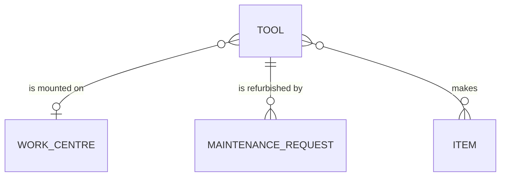
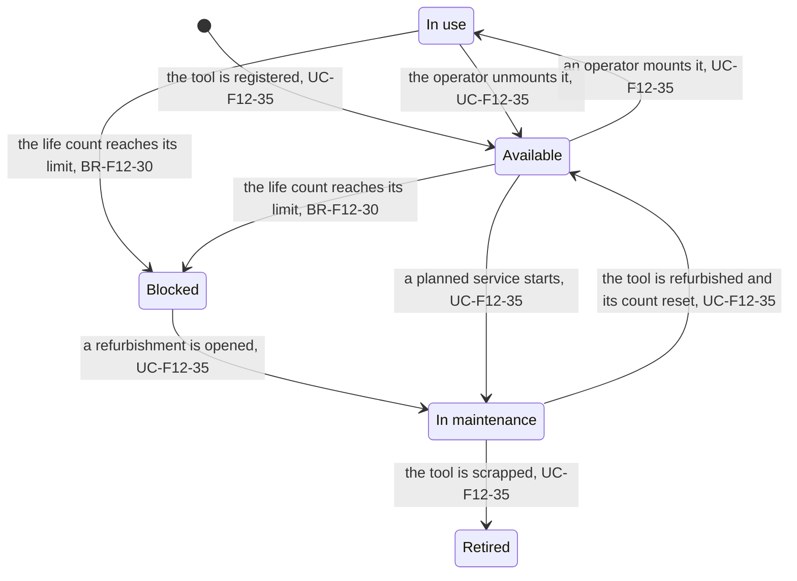

🏠 [Specs](../../../README.md) › 🧩 [Functional capabilities](../../README.md) ›
🏭 [F12 Manufacturing (plugin)](../README.md) › 🗃️ [Data](README.md) › 🗃️ E-F12-33 Tool

# 🗃️ E-F12-33 Tool

**Status:** ✅ specified

## Purpose

A tool, mould, die or fixture with its life limit, count and services
([D531](../../../06-decisions/f12-manufacturing/d531-benchmark-gaps-f12-manufacturing.md)).

## Fields

| Name | Type | Required | Validation | Default | Example | Personal data | Custom fields |
|---|---|---|---|---|---|---|---|
| reference | text | yes | unique | - | M-17 | no | no |
| kind | mould, die, jig, fixture | yes | - | - | mould | no | no |
| life limit | shots or cycles | yes | above 0 | - | 100000 | no | no |
| count | number | yes | 0 or above | 0 | 98200 | no | no |
| warning at | percent | yes | 1 to 100 | 90 | 90 | no | no |
| mounted on | work centre | when in use | - | - | Press 2 | no | no |
| service interval | months | no | - | - | 12 | no | no |
| last refurbished | date | no | - | - | 2026-02-10 | no | no |
| state | available, in use, blocked, in maintenance, retired | yes | the lifecycle below | available | available | no | no |

## Relations

- [E-F12-02 Work centre](e-f12-02-work-centre.md)
- [E-F12-05 Work order](e-f12-05-work-order.md)
- [E-F12-10 Maintenance request](e-f12-10-maintenance-request.md)
- [E-F12-13 Machine signal](e-f12-13-machine-signal.md)

## Lifecycle

## Indexes and search

By reference, kind, state and count against the limit; the tools near their limit.

## Retention

Kept with its counts and services for 10 years after retirement.

## Audit

Every mount, count, block, extension, reset and retirement, with the order and the quantity.

## Import and export

CSV import of tools at set-up; CSV export of the counts.

## Used by

- [UC-F12-35 Manage tools and moulds](../use-cases/14-cad-kanban-mps-and-tools/uc-f12-35-manage-tools-and-moulds.md)

## Open questions

None.

---

⬅️ [E-F12-32 MPS line](e-f12-32-mps-line.md) · ⬆️ [Up](README.md)
