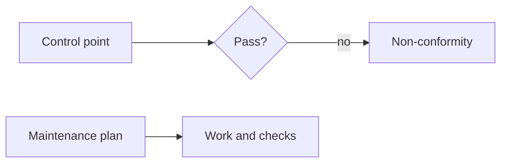

🏠 [Specs](../../../README.md) › 🧩 [Functional capabilities](../../README.md) ›
🏭 [F12 Manufacturing (plugin)](../README.md) › 🔀 [Flows](README.md) › 🔀 FL-F12-04 Quality and maintenance

# 🔀 FL-F12-04 Quality and maintenance

**Status:** ✅ specified

## Summary

Covers UC-F12-07, UC-F12-08.

## Personas

- [U20 Production operator](../../../01-users/personas/u20-production-operator.md)
- [U21 Production planner](../../../01-users/personas/u21-production-planner.md)

## Flowchart

## Sequence diagram

See each use case.

## Steps

| Step | Persona | Screen | Use case | What happens |
|---|---|---|---|---|
| 1 | U20, U21 | [S-F12-07](../screens/04-quality-and-maintenance/s-f12-07-quality-checks.md) | [UC-F12-07](../use-cases/04-quality-and-maintenance/uc-f12-07-run-quality-checks-and-handle-non-conformities.md) | Run quality checks and handle non-conformities |
| 2 | U21, U20 | [S-F12-08](../screens/04-quality-and-maintenance/s-f12-08-maintenance.md) | [UC-F12-08](../use-cases/04-quality-and-maintenance/uc-f12-08-maintain-equipment.md) | Maintain equipment |

### Entities and screens

| Entity | States in this flow | Shown at step and screen | Aggregated view |
|---|---|---|---|
| [E-F12-07 Quality control point](../data/e-f12-07-quality-control-point.md) | Active | 1 [S-F12-07](../screens/04-quality-and-maintenance/s-f12-07-quality-checks.md) | Quality control points |
| [E-F12-08 Non-conformity](../data/e-f12-08-non-conformity.md) | Open, In progress, Closed | 1 [S-F12-07](../screens/04-quality-and-maintenance/s-f12-07-quality-checks.md) | Non-conformities |
| [E-F12-10 Maintenance request](../data/e-f12-10-maintenance-request.md) | Active | 2 [S-F12-08](../screens/04-quality-and-maintenance/s-f12-08-maintenance.md) | Maintenance requests |
| [E-F12-09 Equipment](../data/e-f12-09-equipment.md) | Active | 2 [S-F12-08](../screens/04-quality-and-maintenance/s-f12-08-maintenance.md) | Equipments |

## Errors

As each use case.

## Images

Every step and error, for each persona taking part, in light and dark mode (D120). Steps are numbered as in the Steps
table; E rows are the error cases.

| Step | Persona | Device | Light | Dark |
|---|---|---|---|---|
| 1 | U20 | tablet | [light](../images/04-quality-and-maintenance/u20-production-operator/1-quality-check-tablet-light.png) | [dark](../images/04-quality-and-maintenance/u20-production-operator/1-quality-check-tablet-dark.png) |
| 1 | U21 | desktop | [light](../images/04-quality-and-maintenance/u21-production-planner/1-quality-check-desktop-light.png) | [dark](../images/04-quality-and-maintenance/u21-production-planner/1-quality-check-desktop-dark.png) |
| 1 | U21 | phone | [light](../images/04-quality-and-maintenance/u21-production-planner/1-quality-check-phone-light.png) | [dark](../images/04-quality-and-maintenance/u21-production-planner/1-quality-check-phone-dark.png) |
| 2 | U21 | desktop | [light](../images/04-quality-and-maintenance/u21-production-planner/2-maintenance-desktop-light.png) | [dark](../images/04-quality-and-maintenance/u21-production-planner/2-maintenance-desktop-dark.png) |
| 2 | U21 | phone | [light](../images/04-quality-and-maintenance/u21-production-planner/2-maintenance-phone-light.png) | [dark](../images/04-quality-and-maintenance/u21-production-planner/2-maintenance-phone-dark.png) |
| 2 | U20 | tablet | [light](../images/04-quality-and-maintenance/u20-production-operator/2-maintenance-tablet-light.png) | [dark](../images/04-quality-and-maintenance/u20-production-operator/2-maintenance-tablet-dark.png) |
| E1 | U20 | tablet | [light](../images/04-quality-and-maintenance/u20-production-operator/e1-check-failed-tablet-light.png) | [dark](../images/04-quality-and-maintenance/u20-production-operator/e1-check-failed-tablet-dark.png) |

## Open questions

None.

---

⬅️ [FL-F12-03 Make the products](fl-f12-03-make-the-products.md) · ⬆️ [Up](README.md) ·
➡️ [FL-F12-05 Subcontracting and costs](fl-f12-05-subcontracting-and-costs.md)
