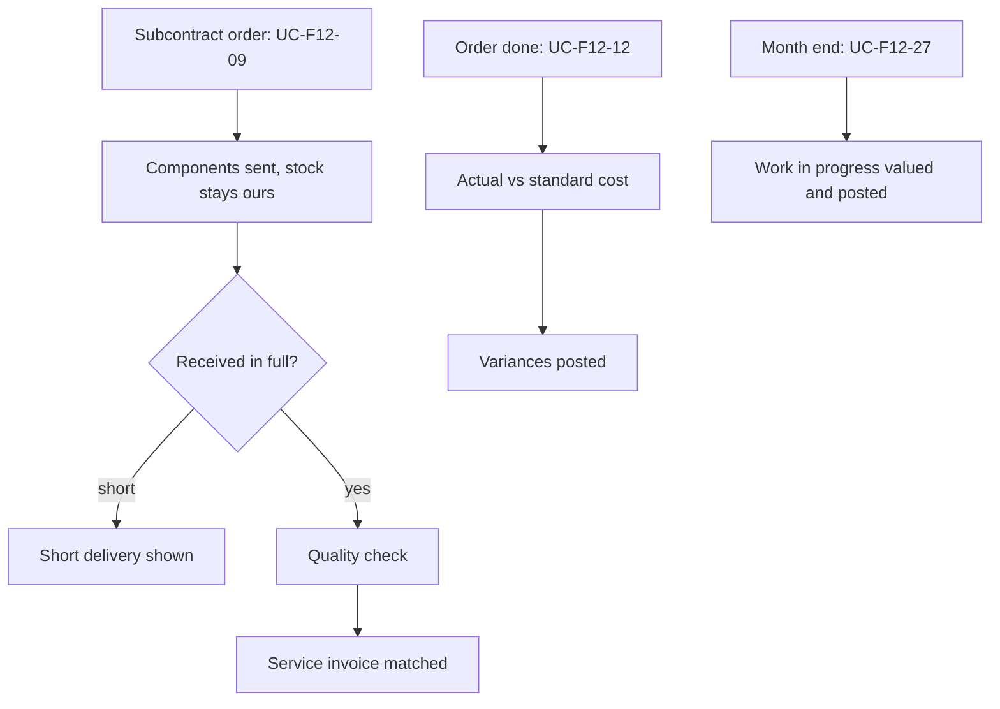

🏠 [Specs](../../../README.md) › 🧩 [Functional capabilities](../../README.md) ›
🏭 [F12 Manufacturing (plugin)](../README.md) › 🔀 [Flows](README.md) › 🔀 FL-F12-05 Subcontracting and costs

# 🔀 FL-F12-05 Subcontracting and costs

**Status:** ✅ specified

## Summary

Work sent to subcontractors and the cost of production: components sent, finished goods received and checked, the
service invoiced; each order costed at standard and actual, variances posted, and work in progress valued at month end.

## Personas

- [U04 Purchasing and stock](../../../01-users/personas/u04-purchasing.md)
- [U05 Accounting](../../../01-users/personas/u05-accounting.md)
- [U21 Production planner](../../../01-users/personas/u21-production-planner.md)

## Flowchart

## Sequence diagram

See each use case.

## Steps

| Step | Persona | Screen | Use case | What happens |
|---|---|---|---|---|
| 1 | [U04](../../../01-users/personas/u04-purchasing.md) | [S-F12-09](../screens/05-subcontracting-and-costs/s-f12-09-subcontracting.md) | [UC-F12-09](../use-cases/05-subcontracting-and-costs/uc-f12-09-subcontract-manufacturing.md) | Order the subcontracted work and send components |
| 2 | [U21](../../../01-users/personas/u21-production-planner.md) | [S-F12-09](../screens/05-subcontracting-and-costs/s-f12-09-subcontracting.md) | [UC-F12-09](../use-cases/05-subcontracting-and-costs/uc-f12-09-subcontract-manufacturing.md) | Receive and check the finished goods |
| 3 | [U05](../../../01-users/personas/u05-accounting.md) | [S-F12-12](../screens/05-subcontracting-and-costs/s-f12-12-production-cost-variance.md) | [UC-F12-12](../use-cases/05-subcontracting-and-costs/uc-f12-12-cost-production.md) | Compare actual and standard costs, post variances |
| 4 | [U05](../../../01-users/personas/u05-accounting.md) | [S-F12-26](../screens/05-subcontracting-and-costs/s-f12-26-work-in-progress.md) | [UC-F12-27](../use-cases/05-subcontracting-and-costs/uc-f12-27-value-work-in-progress-at-month-end.md) | Value work in progress at month end |

### Entities and screens

| Entity | States in this flow | Shown at step and screen | Aggregated view |
|---|---|---|---|
| [E-F7-03 Purchase order](../../f07-purchasing-and-stock/data/e-f07-03-purchase-order.md) | Sent, Received | Shown elsewhere: [S-F7-02 Purchase order](../../f07-purchasing-and-stock/screens/01-procure/s-f07-02-purchase-order.md) | Purchase orders |
| [E-F12-04 Manufacturing order](../data/e-f12-04-manufacturing-order.md) | Draft, Confirmed, In progress, Done | 1, 2 [S-F12-09](../screens/05-subcontracting-and-costs/s-f12-09-subcontracting.md); 3 [S-F12-12](../screens/05-subcontracting-and-costs/s-f12-12-production-cost-variance.md); 4 [S-F12-26](../screens/05-subcontracting-and-costs/s-f12-26-work-in-progress.md) | Manufacturing orders |
| [E-F7-06 Item](../../f07-purchasing-and-stock/data/e-f07-06-item.md) | Active | Shown elsewhere: [S-F7-21 Stock levels](../../f07-purchasing-and-stock/screens/03-replenish/s-f07-21-stock-levels.md) | Items |
| [E-F7-04 Transfer](../../f07-purchasing-and-stock/data/e-f07-04-transfer.md) | Sent, Received | Shown elsewhere: [S-F10-25 Store stock and transfers](../../f10-point-of-sale/screens/10-clienteling-transfers-and-tax-free/s-f10-25-store-stock-and-transfers.md) | Transfers |
| [E-F12-07 Quality control point](../data/e-f12-07-quality-control-point.md) | Active | Shown elsewhere: [S-F12-07 Quality checks](../screens/04-quality-and-maintenance/s-f12-07-quality-checks.md) | Quality control points |
| [E-F7-05 Supplier invoice](../../f07-purchasing-and-stock/data/e-f07-05-supplier-invoice.md) | Received, Matched | Shown elsewhere: [S-F7-04 Supplier invoice matching](../../f07-purchasing-and-stock/screens/01-procure/s-f07-04-supplier-invoice-matching.md) | Supplier invoices |
| [E-F8-10 Fiscal period](../../f08-accounting/data/e-f08-10-fiscal-period.md) | Active | Shown elsewhere: [S-F8-01 Books setup](../../f08-accounting/screens/01-set-up-and-post/s-f08-01-books-setup.md) | Fiscal periods |
| [E-F12-21 Work-in-progress valuation](../data/e-f12-21-work-in-progress-valuation.md) | Active | 4 [S-F12-26](../screens/05-subcontracting-and-costs/s-f12-26-work-in-progress.md) | Work-in-progress valuations |

## Errors

A short delivery, a work centre without a rate, an invoice above the agreed price (BR-F12-11, BR-F12-12, BR-F12-22).

## Images

Every step and error, for each persona taking part, in light and dark mode (D120). Steps are numbered as in the Steps
table; E rows are the error cases.

| Step | Persona | Device | Light | Dark |
|---|---|---|---|---|
| 1 | U21 | desktop | [light](../images/05-subcontracting-and-costs/u21-production-planner/1-subcontracting-desktop-light.png) | [dark](../images/05-subcontracting-and-costs/u21-production-planner/1-subcontracting-desktop-dark.png) |
| 1 | U04 | desktop | [light](../images/05-subcontracting-and-costs/u04-purchasing/1-subcontracting-desktop-light.png) | [dark](../images/05-subcontracting-and-costs/u04-purchasing/1-subcontracting-desktop-dark.png) |
| 2 | U05 | desktop | [light](../images/05-subcontracting-and-costs/u05-accounting/2-costs-desktop-light.png) | [dark](../images/05-subcontracting-and-costs/u05-accounting/2-costs-desktop-dark.png) |
| 2 | U21 | desktop | [light](../images/05-subcontracting-and-costs/u21-production-planner/2-costs-desktop-light.png) | [dark](../images/05-subcontracting-and-costs/u21-production-planner/2-costs-desktop-dark.png) |
| 2 | U21 | phone | [light](../images/05-subcontracting-and-costs/u21-production-planner/2-costs-phone-light.png) | [dark](../images/05-subcontracting-and-costs/u21-production-planner/2-costs-phone-dark.png) |
| E1 | U05 | desktop | [light](../images/05-subcontracting-and-costs/u05-accounting/e1-rate-missing-desktop-light.png) | [dark](../images/05-subcontracting-and-costs/u05-accounting/e1-rate-missing-desktop-dark.png) |
| 3 | U05 | desktop | [light](../images/05-subcontracting-and-costs/u05-accounting/3-production-costs-desktop-light.png) | [dark](../images/05-subcontracting-and-costs/u05-accounting/3-production-costs-desktop-dark.png) |
| 4 | U05 | desktop | [light](../images/05-subcontracting-and-costs/u05-accounting/4-work-in-progress-desktop-light.png) | [dark](../images/05-subcontracting-and-costs/u05-accounting/4-work-in-progress-desktop-dark.png) |

## Open questions

None.

---

⬅️ [FL-F12-04 Quality and maintenance](fl-f12-04-quality-and-maintenance.md) · ⬆️ [Up](README.md) ·
➡️ [FL-F12-06 Machines and OEE](fl-f12-06-machines-and-oee.md)
