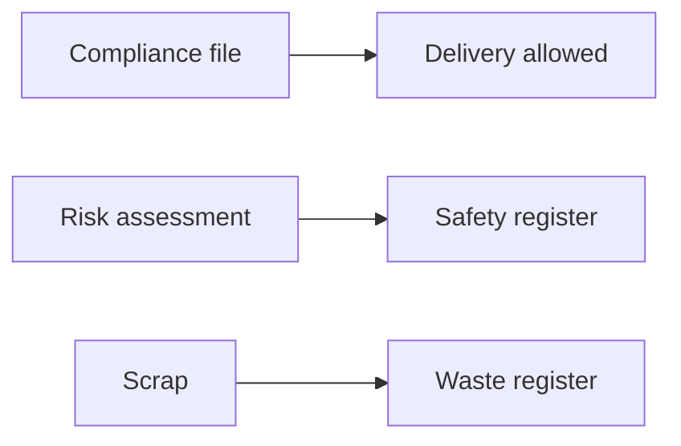

🏠 [Specs](../../../README.md) › 🧩 [Functional capabilities](../../README.md) ›
🏭 [F12 Manufacturing (plugin)](../README.md) › 🔀 [Flows](README.md) › 🔀 FL-F12-07 Compliance and safety

# 🔀 FL-F12-07 Compliance and safety

**Status:** ✅ specified

## Summary

Covers UC-F12-16, UC-F12-17, UC-F12-18.

## Personas

- [U02 Manager](../../../01-users/personas/u02-manager.md)
- [U07 Administrator](../../../01-users/personas/u07-administrator.md)
- [U15 Warehouse operator](../../../01-users/personas/u15-warehouse-operator.md)
- [U21 Production planner](../../../01-users/personas/u21-production-planner.md)

## Flowchart

## Sequence diagram

See each use case.

## Steps

| Step | Persona | Screen | Use case | What happens |
|---|---|---|---|---|
| 1 | U21, U07 | [S-F12-16](../screens/07-compliance-and-safety/s-f12-16-compliance-file.md) | [UC-F12-16](../use-cases/07-compliance-and-safety/uc-f12-16-record-product-compliance.md) | Record product compliance |
| 2 | U02, U21 | [S-F12-17](../screens/07-compliance-and-safety/s-f12-17-safety-registers.md) | [UC-F12-17](../use-cases/07-compliance-and-safety/uc-f12-17-keep-the-risk-assessment-and-safety-registers.md) | Keep the risk assessment and safety registers |
| 3 | U21, U15 | [S-F12-18](../screens/07-compliance-and-safety/s-f12-18-waste-register.md) | [UC-F12-18](../use-cases/07-compliance-and-safety/uc-f12-18-track-waste-and-environmental-records.md) | Track waste and environmental records |

### Entities and screens

| Entity | States in this flow | Shown at step and screen | Aggregated view |
|---|---|---|---|
| [E-F12-14 Product compliance file](../data/e-f12-14-product-compliance-file.md) | Complete, Incomplete | 1 [S-F12-16](../screens/07-compliance-and-safety/s-f12-16-compliance-file.md) | Product compliance files |
| [E-F12-26 Risk assessment](../data/e-f12-26-risk-assessment.md) | Active | 2 [S-F12-17](../screens/07-compliance-and-safety/s-f12-17-safety-registers.md) | Risk assessments |
| [E-F12-27 Safety register](../data/e-f12-27-safety-register.md) | Active | 2 [S-F12-17](../screens/07-compliance-and-safety/s-f12-17-safety-registers.md) | Safety registers |
| [E-F7-04 Transfer](../../f07-purchasing-and-stock/data/e-f07-04-transfer.md) | Sent, Received, Lost, Reserved, Flagged | Shown elsewhere: [S-F10-25 Store stock and transfers](../../f10-point-of-sale/screens/10-clienteling-transfers-and-tax-free/s-f10-25-store-stock-and-transfers.md) | Transfers |
| [E-F12-15 Waste register line](../data/e-f12-15-waste-register-line.md) | Recorded | 3 [S-F12-18](../screens/07-compliance-and-safety/s-f12-18-waste-register.md) | Waste register lines |

## Errors

As each use case.

## Images

Every step and error, for each persona taking part, in light and dark mode (D120). Steps are numbered as in the Steps
table; E rows are the error cases.

| Step | Persona | Device | Light | Dark |
|---|---|---|---|---|
| 1 | U21 | desktop | [light](../images/07-compliance-and-safety/u21-production-planner/1-compliance-file-desktop-light.png) | [dark](../images/07-compliance-and-safety/u21-production-planner/1-compliance-file-desktop-dark.png) |
| 1 | U21 | phone | [light](../images/07-compliance-and-safety/u21-production-planner/1-compliance-file-phone-light.png) | [dark](../images/07-compliance-and-safety/u21-production-planner/1-compliance-file-phone-dark.png) |
| 1 | U07 | desktop | [light](../images/07-compliance-and-safety/u07-administrator/1-compliance-file-desktop-light.png) | [dark](../images/07-compliance-and-safety/u07-administrator/1-compliance-file-desktop-dark.png) |
| 2 | U02 | desktop | [light](../images/07-compliance-and-safety/u02-manager/2-safety-registers-desktop-light.png) | [dark](../images/07-compliance-and-safety/u02-manager/2-safety-registers-desktop-dark.png) |
| 2 | U02 | phone | [light](../images/07-compliance-and-safety/u02-manager/2-safety-registers-phone-light.png) | [dark](../images/07-compliance-and-safety/u02-manager/2-safety-registers-phone-dark.png) |
| 2 | U21 | desktop | [light](../images/07-compliance-and-safety/u21-production-planner/2-safety-registers-desktop-light.png) | [dark](../images/07-compliance-and-safety/u21-production-planner/2-safety-registers-desktop-dark.png) |
| 2 | U21 | phone | [light](../images/07-compliance-and-safety/u21-production-planner/2-safety-registers-phone-light.png) | [dark](../images/07-compliance-and-safety/u21-production-planner/2-safety-registers-phone-dark.png) |
| 3 | U15 | phone | [light](../images/07-compliance-and-safety/u15-warehouse-operator/3-waste-register-phone-light.png) | [dark](../images/07-compliance-and-safety/u15-warehouse-operator/3-waste-register-phone-dark.png) |
| 3 | U15 | tablet | [light](../images/07-compliance-and-safety/u15-warehouse-operator/3-waste-register-tablet-light.png) | [dark](../images/07-compliance-and-safety/u15-warehouse-operator/3-waste-register-tablet-dark.png) |
| 3 | U21 | desktop | [light](../images/07-compliance-and-safety/u21-production-planner/3-waste-register-desktop-light.png) | [dark](../images/07-compliance-and-safety/u21-production-planner/3-waste-register-desktop-dark.png) |
| 3 | U21 | phone | [light](../images/07-compliance-and-safety/u21-production-planner/3-waste-register-phone-light.png) | [dark](../images/07-compliance-and-safety/u21-production-planner/3-waste-register-phone-dark.png) |
| E1 | U21 | desktop | [light](../images/07-compliance-and-safety/u21-production-planner/e1-file-incomplete-desktop-light.png) | [dark](../images/07-compliance-and-safety/u21-production-planner/e1-file-incomplete-desktop-dark.png) |
| E1 | U21 | phone | [light](../images/07-compliance-and-safety/u21-production-planner/e1-file-incomplete-phone-light.png) | [dark](../images/07-compliance-and-safety/u21-production-planner/e1-file-incomplete-phone-dark.png) |

## Open questions

None.

---

⬅️ [FL-F12-06 Machines and OEE](fl-f12-06-machines-and-oee.md) · ⬆️ [Up](README.md) ·
➡️ [FL-F12-08 Report and assist](fl-f12-08-report-and-assist.md)
