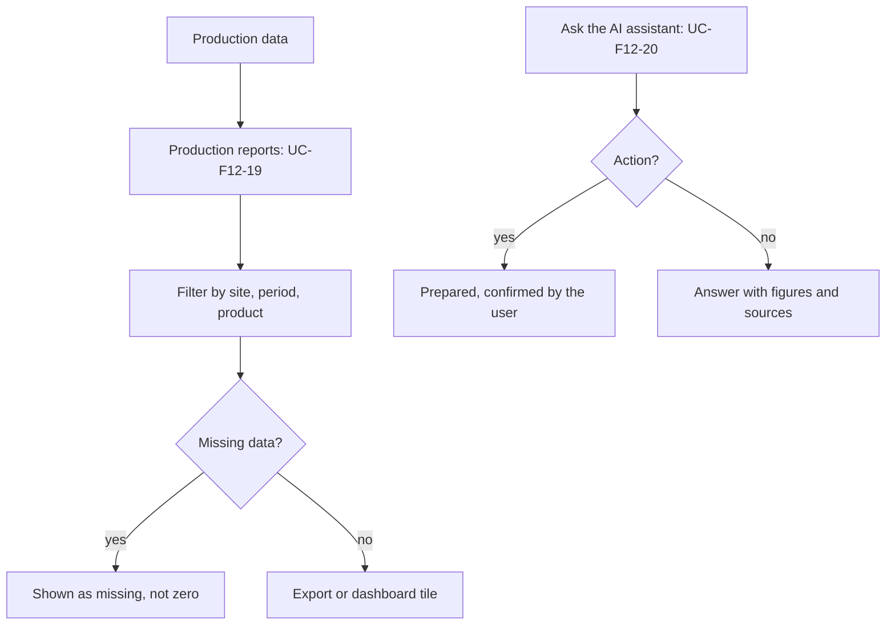

🏠 [Specs](../../../README.md) › 🧩 [Functional capabilities](../../README.md) ›
🏭 [F12 Manufacturing (plugin)](../README.md) › 🔀 [Flows](README.md) › 🔀 FL-F12-08 Report and assist

# 🔀 FL-F12-08 Report and assist

**Status:** ✅ specified

## Summary

Production reported by site and period (output, lead times, on-time rate, scrap, costs, load, energy) and the production
assistant, which answers and prepares actions within the role's rights.

## Personas

- [U13 Owner](../../../01-users/personas/u13-owner.md)
- [U20 Production operator](../../../01-users/personas/u20-production-operator.md)
- [U21 Production planner](../../../01-users/personas/u21-production-planner.md)

## Flowchart

## Sequence diagram

See each use case.

## Steps

| Step | Persona | Screen | Use case | What happens |
|---|---|---|---|---|
| 1 | [U13](../../../01-users/personas/u13-owner.md) | [S-F12-19](../screens/08-report-and-assist/s-f12-19-manufacturing-dashboard.md) | [UC-F12-19](../use-cases/08-report-and-assist/uc-f12-19-report-production.md) | Read output, on-time rate, scrap and costs by site |
| 2 | [U21](../../../01-users/personas/u21-production-planner.md) | [S-F12-19](../screens/08-report-and-assist/s-f12-19-manufacturing-dashboard.md) | [UC-F12-19](../use-cases/08-report-and-assist/uc-f12-19-report-production.md) | Compare periods and export |
| 3 | [U21](../../../01-users/personas/u21-production-planner.md) | [S-F12-20](../screens/08-report-and-assist/s-f12-20-production-assistant.md) | [UC-F12-20](../use-cases/08-report-and-assist/uc-f12-20-ask-the-assistant-about-production.md) | Ask the AI assistant which orders are late |
| 4 | [U20](../../../01-users/personas/u20-production-operator.md) | [S-F12-20](../screens/08-report-and-assist/s-f12-20-production-assistant.md) | [UC-F12-20](../use-cases/08-report-and-assist/uc-f12-20-ask-the-assistant-about-production.md) | Have the next instruction read aloud at the machine |

### Entities and screens

| Entity | States in this flow | Shown at step and screen | Aggregated view |
|---|---|---|---|
| [E-F1-02 Company site](../../f01-administration/data/e-f01-02-company-site.md) | Open, Closed | Shown elsewhere: [S-F1-02 Sites](../../f01-administration/screens/02-manage-sites/s-f01-02-sites.md) | Company sites |
| [E-F7-06 Item](../../f07-purchasing-and-stock/data/e-f07-06-item.md) | Active | Shown elsewhere: [S-F7-21 Stock levels](../../f07-purchasing-and-stock/screens/03-replenish/s-f07-21-stock-levels.md) | Items |
| [E-F3-04 Assistant change batch](../../f03-assistant/data/e-f03-04-assistant-change-batch.md) | Proposed, Cancelled, Done, Partly done, Undone | Shown elsewhere: [S-F3-01 Assistant panel](../../f03-assistant/screens/01-ask-the-assistant/s-f03-01-assistant-panel.md) | Assistant change batches |
| [E-F1-03 User](../../f01-administration/data/e-f01-03-user.md) | Invited, Active, Deactivated | Shown elsewhere: [S-F1-03 Users](../../f01-administration/screens/03-user-lifecycle/s-f01-03-users.md) | Users |
| [E-F3-02 Assistant answer](../../f03-assistant/data/e-f03-02-assistant-answer.md) | Recorded | Shown elsewhere: [S-F3-01 Assistant panel](../../f03-assistant/screens/01-ask-the-assistant/s-f03-01-assistant-panel.md) | Assistant answers |

## Errors

A period without data, an action beyond the role's rights (BR-F3-07).

## Images

Every step and error, for each persona taking part, in light and dark mode (D120). Steps are numbered as in the Steps
table; E rows are the error cases.

| Step | Persona | Device | Light | Dark |
|---|---|---|---|---|
| 1 | U13 | desktop | [light](../images/08-report-and-assist/u13-owner/1-reports-desktop-light.png) | [dark](../images/08-report-and-assist/u13-owner/1-reports-desktop-dark.png) |
| 1 | U13 | phone | [light](../images/08-report-and-assist/u13-owner/1-reports-phone-light.png) | [dark](../images/08-report-and-assist/u13-owner/1-reports-phone-dark.png) |
| 2 | U20 | tablet | [light](../images/08-report-and-assist/u20-production-operator/2-assistant-tablet-light.png) | [dark](../images/08-report-and-assist/u20-production-operator/2-assistant-tablet-dark.png) |
| 2 | U21 | desktop | [light](../images/08-report-and-assist/u21-production-planner/2-assistant-desktop-light.png) | [dark](../images/08-report-and-assist/u21-production-planner/2-assistant-desktop-dark.png) |
| 2 | U21 | phone | [light](../images/08-report-and-assist/u21-production-planner/2-assistant-phone-light.png) | [dark](../images/08-report-and-assist/u21-production-planner/2-assistant-phone-dark.png) |
| E1 | U20 | tablet | [light](../images/08-report-and-assist/u20-production-operator/e1-beyond-rights-tablet-light.png) | [dark](../images/08-report-and-assist/u20-production-operator/e1-beyond-rights-tablet-dark.png) |
| 3 | U21 | desktop | [light](../images/08-report-and-assist/u21-production-planner/3-production-assistant-desktop-light.png) | [dark](../images/08-report-and-assist/u21-production-planner/3-production-assistant-desktop-dark.png) |
| 3 | U21 | phone | [light](../images/08-report-and-assist/u21-production-planner/3-production-assistant-phone-light.png) | [dark](../images/08-report-and-assist/u21-production-planner/3-production-assistant-phone-dark.png) |
| 4 | U20 | tablet | [light](../images/08-report-and-assist/u20-production-operator/4-production-assistant-tablet-light.png) | [dark](../images/08-report-and-assist/u20-production-operator/4-production-assistant-tablet-dark.png) |

## Open questions

None.

---

⬅️ [FL-F12-07 Compliance and safety](fl-f12-07-compliance-and-safety.md) · ⬆️ [Up](README.md) ·
➡️ [FL-F12-09 Recipes and batches](fl-f12-09-recipes-and-batches.md)
