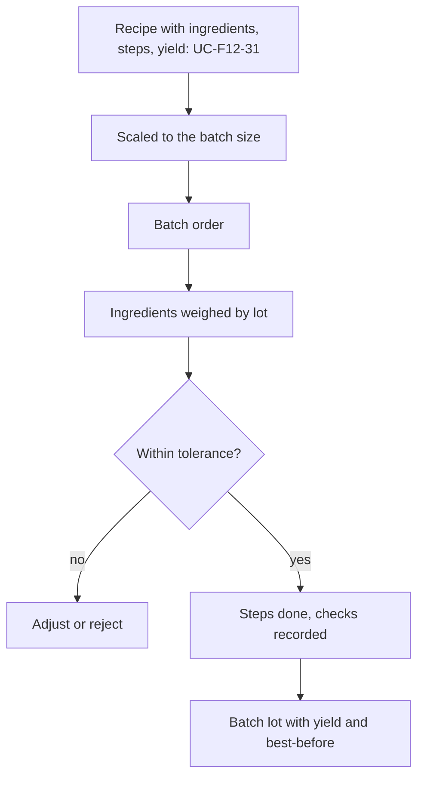

🏠 [Specs](../../../README.md) › 🧩 [Functional capabilities](../../README.md) ›
🏭 [F12 Manufacturing (plugin)](../README.md) › 🔀 [Flows](README.md) › 🔀 FL-F12-09 Recipes and batches

# 🔀 FL-F12-09 Recipes and batches

**Status:** ✅ specified

## Summary

The shared recipe model of D457: ingredients with tolerances, steps and yields, scaled to a batch size, produced in
traced batches; used by the food workshop, the restaurant kitchen and the farm.

## Personas

- [U20 Production operator](../../../01-users/personas/u20-production-operator.md)
- [U21 Production planner](../../../01-users/personas/u21-production-planner.md)

## Flowchart

## Sequence diagram

- [UC-F12-31 Define a recipe and produce in batches](../use-cases/09-recipes-and-batches/uc-f12-31-define-a-recipe-and-produce-in-batches.md#sequence-diagram)

## Steps

| Step | Persona | Screen | Use case | What happens |
|---|---|---|---|---|
| 1 | [U21](../../../01-users/personas/u21-production-planner.md) | [S-F12-30](../screens/09-recipes-and-batches/s-f12-30-recipe-and-batch.md) | [UC-F12-31](../use-cases/09-recipes-and-batches/uc-f12-31-define-a-recipe-and-produce-in-batches.md) | Define a recipe with tolerances and yield |
| 2 | [U21](../../../01-users/personas/u21-production-planner.md) | [S-F12-30](../screens/09-recipes-and-batches/s-f12-30-recipe-and-batch.md) | [UC-F12-31](../use-cases/09-recipes-and-batches/uc-f12-31-define-a-recipe-and-produce-in-batches.md) | Plan a batch scaled to its size |
| 3 | [U20](../../../01-users/personas/u20-production-operator.md) | [S-F12-05](../screens/03-make-the-products/s-f12-05-shop-floor-tablet.md) | [UC-F12-31](../use-cases/09-recipes-and-batches/uc-f12-31-define-a-recipe-and-produce-in-batches.md) | Weigh ingredients by lot and record the steps |
| 4 | [U20](../../../01-users/personas/u20-production-operator.md) | [S-F12-06](../screens/03-make-the-products/s-f12-06-consumption.md) | [UC-F12-31](../use-cases/09-recipes-and-batches/uc-f12-31-define-a-recipe-and-produce-in-batches.md) | Close the batch with its lot and yield |

### Entities and screens

| Entity | States in this flow | Shown at step and screen | Aggregated view |
|---|---|---|---|
| [E-F12-25 Recipe](../data/e-f12-25-recipe.md) | Draft, Approved, Superseded | 1, 2 [S-F12-30](../screens/09-recipes-and-batches/s-f12-30-recipe-and-batch.md); 3 [S-F12-05](../screens/03-make-the-products/s-f12-05-shop-floor-tablet.md); 4 [S-F12-06](../screens/03-make-the-products/s-f12-06-consumption.md) | Recipes |
| [E-F7-06 Item](../../f07-purchasing-and-stock/data/e-f07-06-item.md) | Active | Shown elsewhere: [S-F7-21 Stock levels](../../f07-purchasing-and-stock/screens/03-replenish/s-f07-21-stock-levels.md) | Items |
| [E-F12-04 Manufacturing order](../data/e-f12-04-manufacturing-order.md) | Draft, Confirmed, In progress, Done | 1, 2 [S-F12-30](../screens/09-recipes-and-batches/s-f12-30-recipe-and-batch.md); 3 [S-F12-05](../screens/03-make-the-products/s-f12-05-shop-floor-tablet.md); 4 [S-F12-06](../screens/03-make-the-products/s-f12-06-consumption.md) | Manufacturing orders |
| [E-F7-10 Lot or serial](../../f07-purchasing-and-stock/data/e-f07-10-lot-or-serial.md) | Active | Shown elsewhere: [S-F7-03 Receipt](../../f07-purchasing-and-stock/screens/02-receive-and-store/s-f07-03-receipt.md) | Lot or serials |
| [E-F12-07 Quality control point](../data/e-f12-07-quality-control-point.md) | Active | Shown elsewhere: [S-F12-07 Quality checks](../screens/04-quality-and-maintenance/s-f12-07-quality-checks.md) | Quality control points |

## Errors

An ingredient out of tolerance, an allergen not declared, a yield far from the expected (BR-F12-26).

## Images

Every step and error, for each persona taking part, in light and dark mode (D120). Steps are numbered as in the Steps
table; E rows are the error cases.

| Step | Persona | Device | Light | Dark |
|---|---|---|---|---|
| 1 | U21 | desktop | [light](../images/09-recipes-and-batches/u21-production-planner/1-recipe-and-batch-desktop-light.png) | [dark](../images/09-recipes-and-batches/u21-production-planner/1-recipe-and-batch-desktop-dark.png) |
| 1 | U21 | phone | [light](../images/09-recipes-and-batches/u21-production-planner/1-recipe-and-batch-phone-light.png) | [dark](../images/09-recipes-and-batches/u21-production-planner/1-recipe-and-batch-phone-dark.png) |
| 2 | U21 | desktop | [light](../images/09-recipes-and-batches/u21-production-planner/2-recipe-and-batch-desktop-light.png) | [dark](../images/09-recipes-and-batches/u21-production-planner/2-recipe-and-batch-desktop-dark.png) |
| 2 | U21 | phone | [light](../images/09-recipes-and-batches/u21-production-planner/2-recipe-and-batch-phone-light.png) | [dark](../images/09-recipes-and-batches/u21-production-planner/2-recipe-and-batch-phone-dark.png) |
| 3 | U20 | tablet | [light](../images/09-recipes-and-batches/u20-production-operator/3-shop-floor-tablet-tablet-light.png) | [dark](../images/09-recipes-and-batches/u20-production-operator/3-shop-floor-tablet-tablet-dark.png) |
| 4 | U20 | tablet | [light](../images/09-recipes-and-batches/u20-production-operator/4-consumption-tablet-light.png) | [dark](../images/09-recipes-and-batches/u20-production-operator/4-consumption-tablet-dark.png) |
| E1 | U21 | desktop | [light](../images/09-recipes-and-batches/u21-production-planner/e1-recipe-and-batch-refused-desktop-light.png) | [dark](../images/09-recipes-and-batches/u21-production-planner/e1-recipe-and-batch-refused-desktop-dark.png) |
| E1 | U21 | phone | [light](../images/09-recipes-and-batches/u21-production-planner/e1-recipe-and-batch-refused-phone-light.png) | [dark](../images/09-recipes-and-batches/u21-production-planner/e1-recipe-and-batch-refused-phone-dark.png) |

## Open questions

None.

---

⬅️ [FL-F12-08 Report and assist](fl-f12-08-report-and-assist.md) · ⬆️ [Up](README.md) ·
➡️ [FL-F12-10 People and tools](fl-f12-10-people-and-tools.md)
