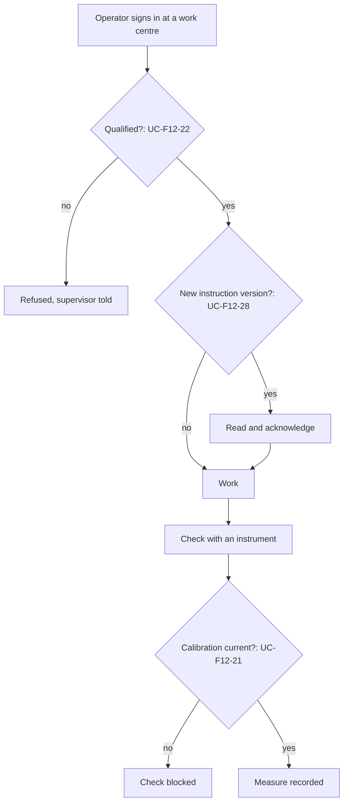

🏠 [Specs](../../../README.md) › 🧩 [Functional capabilities](../../README.md) ›
🏭 [F12 Manufacturing (plugin)](../README.md) › 🔀 [Flows](README.md) › 🔀 FL-F12-10 People and tools

# 🔀 FL-F12-10 People and tools

**Status:** ✅ specified

## Summary

Only qualified operators work at a work centre, only calibrated instruments record checks, and operators acknowledge
each new version of their work instructions.

## Personas

- [U20 Production operator](../../../01-users/personas/u20-production-operator.md)
- [U21 Production planner](../../../01-users/personas/u21-production-planner.md)
- [U27 Quality manager](../../../01-users/personas/u27-quality-manager.md)

## Flowchart

## Sequence diagram

- [UC-F12-22 Require operator qualifications per work centre](../use-cases/10-people-and-tools/uc-f12-22-require-operator-qualifications-per-work-centre.md#sequence-diagram)

## Steps

| Step | Persona | Screen | Use case | What happens |
|---|---|---|---|---|
| 1 | [U27](../../../01-users/personas/u27-quality-manager.md) | [S-F12-21](../screens/10-people-and-tools/s-f12-21-calibration.md) | [UC-F12-21](../use-cases/10-people-and-tools/uc-f12-21-calibrate-measuring-equipment.md) | Calibrate a measuring instrument |
| 2 | [U21](../../../01-users/personas/u21-production-planner.md) | [S-F12-22](../screens/10-people-and-tools/s-f12-22-qualifications-matrix.md) | [UC-F12-22](../use-cases/10-people-and-tools/uc-f12-22-require-operator-qualifications-per-work-centre.md) | Set the qualifications a work centre requires |
| 3 | [U21](../../../01-users/personas/u21-production-planner.md) | [S-F12-27](../screens/10-people-and-tools/s-f12-27-work-instructions.md) | [UC-F12-28](../use-cases/10-people-and-tools/uc-f12-28-publish-versioned-work-instructions.md) | Publish a new version of a work instruction |
| 4 | [U20](../../../01-users/personas/u20-production-operator.md) | [S-F12-05](../screens/03-make-the-products/s-f12-05-shop-floor-tablet.md) | [UC-F12-28](../use-cases/10-people-and-tools/uc-f12-28-publish-versioned-work-instructions.md) | Acknowledge it before starting |

### Entities and screens

| Entity | States in this flow | Shown at step and screen | Aggregated view |
|---|---|---|---|
| [E-F12-02 Work centre](../data/e-f12-02-work-centre.md) | Active | Shown elsewhere: [S-F12-02 Routing](../screens/01-define-the-products/s-f12-02-routing.md) | Work centres |
| [E-F12-05 Work order](../data/e-f12-05-work-order.md) | New | 4 [S-F12-05](../screens/03-make-the-products/s-f12-05-shop-floor-tablet.md) | Work orders |
| [E-F12-22 Work instruction version](../data/e-f12-22-work-instruction-version.md) | Draft, Published, Superseded | 3 [S-F12-27](../screens/10-people-and-tools/s-f12-27-work-instructions.md); 4 [S-F12-05](../screens/03-make-the-products/s-f12-05-shop-floor-tablet.md) | Work instruction versions |
| [E-F12-09 Equipment](../data/e-f12-09-equipment.md) | Active | 1 [S-F12-21](../screens/10-people-and-tools/s-f12-21-calibration.md) | Equipments |
| [E-F12-16 Calibration](../data/e-f12-16-calibration.md) | Blocked | 1 [S-F12-21](../screens/10-people-and-tools/s-f12-21-calibration.md) | Calibrations |

## Errors

An expired qualification, an instrument out of calibration, an instruction not acknowledged (BR-F12-16, BR-F12-17,
BR-F12-23).

## Images

Every step and error, for each persona taking part, in light and dark mode (D120). Steps are numbered as in the Steps
table; E rows are the error cases.

| Step | Persona | Device | Light | Dark |
|---|---|---|---|---|
| 1 | U27 | desktop | [light](../images/10-people-and-tools/u27-quality-manager/1-calibration-desktop-light.png) | [dark](../images/10-people-and-tools/u27-quality-manager/1-calibration-desktop-dark.png) |
| 1 | U27 | tablet | [light](../images/10-people-and-tools/u27-quality-manager/1-calibration-tablet-light.png) | [dark](../images/10-people-and-tools/u27-quality-manager/1-calibration-tablet-dark.png) |
| 2 | U21 | desktop | [light](../images/10-people-and-tools/u21-production-planner/2-qualifications-matrix-desktop-light.png) | [dark](../images/10-people-and-tools/u21-production-planner/2-qualifications-matrix-desktop-dark.png) |
| 2 | U21 | phone | [light](../images/10-people-and-tools/u21-production-planner/2-qualifications-matrix-phone-light.png) | [dark](../images/10-people-and-tools/u21-production-planner/2-qualifications-matrix-phone-dark.png) |
| 3 | U21 | desktop | [light](../images/10-people-and-tools/u21-production-planner/3-work-instructions-desktop-light.png) | [dark](../images/10-people-and-tools/u21-production-planner/3-work-instructions-desktop-dark.png) |
| 3 | U21 | phone | [light](../images/10-people-and-tools/u21-production-planner/3-work-instructions-phone-light.png) | [dark](../images/10-people-and-tools/u21-production-planner/3-work-instructions-phone-dark.png) |
| 4 | U20 | tablet | [light](../images/10-people-and-tools/u20-production-operator/4-shop-floor-tablet-tablet-light.png) | [dark](../images/10-people-and-tools/u20-production-operator/4-shop-floor-tablet-tablet-dark.png) |
| E1 | U27 | desktop | [light](../images/10-people-and-tools/u27-quality-manager/e1-calibration-refused-desktop-light.png) | [dark](../images/10-people-and-tools/u27-quality-manager/e1-calibration-refused-desktop-dark.png) |
| E1 | U27 | tablet | [light](../images/10-people-and-tools/u27-quality-manager/e1-calibration-refused-tablet-light.png) | [dark](../images/10-people-and-tools/u27-quality-manager/e1-calibration-refused-tablet-dark.png) |

## Open questions

None.

---

⬅️ [FL-F12-09 Recipes and batches](fl-f12-09-recipes-and-batches.md) · ⬆️ [Up](README.md) ·
➡️ [FL-F12-11 Finite schedule and the tablet](fl-f12-11-finite-schedule-and-the-tablet.md)
