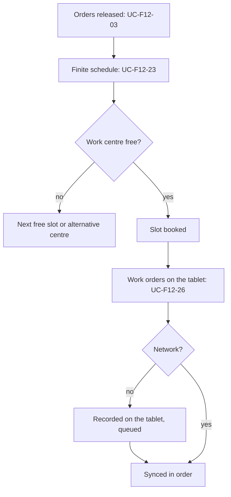

🏠 [Specs](../../../README.md) › 🧩 [Functional capabilities](../../README.md) ›
🏭 [F12 Manufacturing (plugin)](../README.md) › 🔀 [Flows](README.md) › 🔀 FL-F12-11 Finite schedule and the tablet

# 🔀 FL-F12-11 Finite schedule and the tablet

**Status:** ✅ specified

## Summary

Operations scheduled within each work centre's real capacity, and the shop-floor tablet that keeps working without the
network.

## Personas

- [U20 Production operator](../../../01-users/personas/u20-production-operator.md)
- [U21 Production planner](../../../01-users/personas/u21-production-planner.md)

## Flowchart

## Sequence diagram

- [UC-F12-23 Schedule with finite capacity](../use-cases/11-finite-schedule-and-the-tablet/uc-f12-23-schedule-with-finite-capacity.md#sequence-diagram)

## Steps

| Step | Persona | Screen | Use case | What happens |
|---|---|---|---|---|
| 1 | [U21](../../../01-users/personas/u21-production-planner.md) | [S-F12-23](../screens/11-finite-schedule-and-the-tablet/s-f12-23-finite-schedule.md) | [UC-F12-23](../use-cases/11-finite-schedule-and-the-tablet/uc-f12-23-schedule-with-finite-capacity.md) | Schedule operations on finite capacity |
| 2 | [U20](../../../01-users/personas/u20-production-operator.md) | [S-F12-05](../screens/03-make-the-products/s-f12-05-shop-floor-tablet.md) | [UC-F12-26](../use-cases/11-finite-schedule-and-the-tablet/uc-f12-26-keep-working-on-the-tablet-without-the-network.md) | Keep recording on the tablet without the network |

### Entities and screens

| Entity | States in this flow | Shown at step and screen | Aggregated view |
|---|---|---|---|
| [E-F12-04 Manufacturing order](../data/e-f12-04-manufacturing-order.md) | Draft, Confirmed, Cancelled, In progress, Done | 2 [S-F12-05](../screens/03-make-the-products/s-f12-05-shop-floor-tablet.md) | Manufacturing orders |
| [E-F12-18 Schedule slot](../data/e-f12-18-schedule-slot.md) | Planned, Published, Done | 1 [S-F12-23](../screens/11-finite-schedule-and-the-tablet/s-f12-23-finite-schedule.md) | Schedule slots |
| [E-F12-02 Work centre](../data/e-f12-02-work-centre.md) | Active | Shown elsewhere: [S-F12-02 Routing](../screens/01-define-the-products/s-f12-02-routing.md) | Work centres |
| [E-F12-05 Work order](../data/e-f12-05-work-order.md) | New, Done, Late | 1 [S-F12-23](../screens/11-finite-schedule-and-the-tablet/s-f12-23-finite-schedule.md); 2 [S-F12-05](../screens/03-make-the-products/s-f12-05-shop-floor-tablet.md) | Work orders |

## Errors

A due date the schedule cannot meet, a sync conflict on quantities (BR-F12-18, BR-F12-21).

## Images

Every step and error, for each persona taking part, in light and dark mode (D120). Steps are numbered as in the Steps
table; E rows are the error cases.

| Step | Persona | Device | Light | Dark |
|---|---|---|---|---|
| 1 | U21 | desktop | [light](../images/11-finite-schedule-and-the-tablet/u21-production-planner/1-finite-schedule-desktop-light.png) | [dark](../images/11-finite-schedule-and-the-tablet/u21-production-planner/1-finite-schedule-desktop-dark.png) |
| 1 | U21 | phone | [light](../images/11-finite-schedule-and-the-tablet/u21-production-planner/1-finite-schedule-phone-light.png) | [dark](../images/11-finite-schedule-and-the-tablet/u21-production-planner/1-finite-schedule-phone-dark.png) |
| 2 | U20 | tablet | [light](../images/11-finite-schedule-and-the-tablet/u20-production-operator/2-shop-floor-tablet-tablet-light.png) | [dark](../images/11-finite-schedule-and-the-tablet/u20-production-operator/2-shop-floor-tablet-tablet-dark.png) |
| E1 | U21 | desktop | [light](../images/11-finite-schedule-and-the-tablet/u21-production-planner/e1-finite-schedule-refused-desktop-light.png) | [dark](../images/11-finite-schedule-and-the-tablet/u21-production-planner/e1-finite-schedule-refused-desktop-dark.png) |
| E1 | U21 | phone | [light](../images/11-finite-schedule-and-the-tablet/u21-production-planner/e1-finite-schedule-refused-phone-light.png) | [dark](../images/11-finite-schedule-and-the-tablet/u21-production-planner/e1-finite-schedule-refused-phone-dark.png) |

## Open questions

None.

---

⬅️ [FL-F12-10 People and tools](fl-f12-10-people-and-tools.md) · ⬆️ [Up](README.md) ·
➡️ [FL-F12-12 Quality engineering](fl-f12-12-quality-engineering.md)
