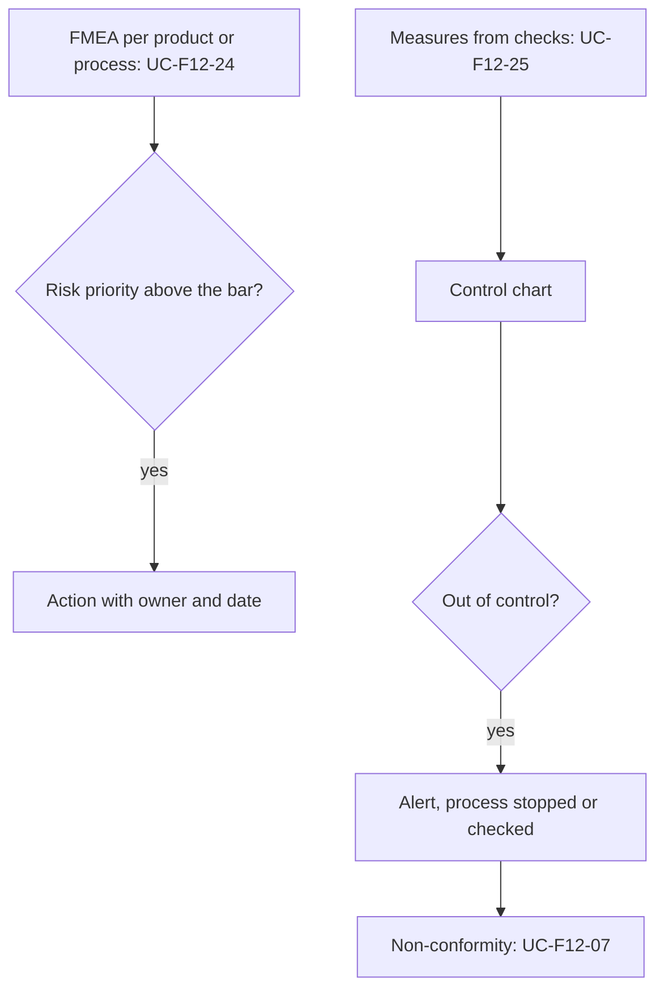

🏠 [Specs](../../../README.md) › 🧩 [Functional capabilities](../../README.md) ›
🏭 [F12 Manufacturing (plugin)](../README.md) › 🔀 [Flows](README.md) › 🔀 FL-F12-12 Quality engineering

# 🔀 FL-F12-12 Quality engineering

**Status:** ✅ specified

## Summary

Failure modes analysed before they happen (FMEA) and processes watched with control charts (SPC).

## Personas

- [U20 Production operator](../../../01-users/personas/u20-production-operator.md)
- [U27 Quality manager](../../../01-users/personas/u27-quality-manager.md)

## Flowchart

## Sequence diagram

- [UC-F12-25 Monitor a process with control charts](../use-cases/12-quality-engineering/uc-f12-25-monitor-a-process-with-control-charts.md#sequence-diagram)

## Steps

| Step | Persona | Screen | Use case | What happens |
|---|---|---|---|---|
| 1 | [U27](../../../01-users/personas/u27-quality-manager.md) | [S-F12-24](../screens/12-quality-engineering/s-f12-24-fmea.md) | [UC-F12-24](../use-cases/12-quality-engineering/uc-f12-24-run-an-fmea.md) | Run an FMEA on a new product |
| 2 | [U20](../../../01-users/personas/u20-production-operator.md) | [S-F12-07](../screens/04-quality-and-maintenance/s-f12-07-quality-checks.md) | [UC-F12-25](../use-cases/12-quality-engineering/uc-f12-25-monitor-a-process-with-control-charts.md) | Record measures at the control point |
| 3 | [U27](../../../01-users/personas/u27-quality-manager.md) | [S-F12-25](../screens/12-quality-engineering/s-f12-25-control-chart.md) | [UC-F12-25](../use-cases/12-quality-engineering/uc-f12-25-monitor-a-process-with-control-charts.md) | Read the control chart and act on a signal |

### Entities and screens

| Entity | States in this flow | Shown at step and screen | Aggregated view |
|---|---|---|---|
| [E-F12-19 FMEA line](../data/e-f12-19-fmea-line.md) | Open, Done | 1 [S-F12-24](../screens/12-quality-engineering/s-f12-24-fmea.md) | FMEA lines |
| [E-F7-06 Item](../../f07-purchasing-and-stock/data/e-f07-06-item.md) | Active | Shown elsewhere: [S-F7-21 Stock levels](../../f07-purchasing-and-stock/screens/03-replenish/s-f07-21-stock-levels.md) | Items |
| [E-F4-04 Action item](../../f04-meetings/data/e-f04-04-action-item.md) | Open, Done | Shown elsewhere: [S-F4-23 Agreed actions](../../f04-meetings/screens/13-outside-people-and-follow-up/s-f04-23-agreed-actions.md) | Action items |
| [E-F12-07 Quality control point](../data/e-f12-07-quality-control-point.md) | Active | 2 [S-F12-07](../screens/04-quality-and-maintenance/s-f12-07-quality-checks.md); 3 [S-F12-25](../screens/12-quality-engineering/s-f12-25-control-chart.md) | Quality control points |
| [E-F12-20 Control chart](../data/e-f12-20-control-chart.md) | Active | 2 [S-F12-07](../screens/04-quality-and-maintenance/s-f12-07-quality-checks.md); 3 [S-F12-25](../screens/12-quality-engineering/s-f12-25-control-chart.md) | Control charts |
| [E-F12-08 Non-conformity](../data/e-f12-08-non-conformity.md) | Open, In progress, Closed | 2 [S-F12-07](../screens/04-quality-and-maintenance/s-f12-07-quality-checks.md) | Non-conformities |

## Errors

An action past its date, too few measures for limits, a false alarm (BR-F12-19, BR-F12-20).

## Images

Every step and error, for each persona taking part, in light and dark mode (D120). Steps are numbered as in the Steps
table; E rows are the error cases.

| Step | Persona | Device | Light | Dark |
|---|---|---|---|---|
| 1 | U27 | desktop | [light](../images/12-quality-engineering/u27-quality-manager/1-fmea-desktop-light.png) | [dark](../images/12-quality-engineering/u27-quality-manager/1-fmea-desktop-dark.png) |
| 1 | U27 | tablet | [light](../images/12-quality-engineering/u27-quality-manager/1-fmea-tablet-light.png) | [dark](../images/12-quality-engineering/u27-quality-manager/1-fmea-tablet-dark.png) |
| 2 | U20 | tablet | [light](../images/12-quality-engineering/u20-production-operator/2-quality-checks-tablet-light.png) | [dark](../images/12-quality-engineering/u20-production-operator/2-quality-checks-tablet-dark.png) |
| 3 | U27 | desktop | [light](../images/12-quality-engineering/u27-quality-manager/3-control-chart-desktop-light.png) | [dark](../images/12-quality-engineering/u27-quality-manager/3-control-chart-desktop-dark.png) |
| 3 | U27 | tablet | [light](../images/12-quality-engineering/u27-quality-manager/3-control-chart-tablet-light.png) | [dark](../images/12-quality-engineering/u27-quality-manager/3-control-chart-tablet-dark.png) |
| E1 | U27 | desktop | [light](../images/12-quality-engineering/u27-quality-manager/e1-fmea-refused-desktop-light.png) | [dark](../images/12-quality-engineering/u27-quality-manager/e1-fmea-refused-desktop-dark.png) |
| E1 | U27 | tablet | [light](../images/12-quality-engineering/u27-quality-manager/e1-fmea-refused-tablet-light.png) | [dark](../images/12-quality-engineering/u27-quality-manager/e1-fmea-refused-tablet-dark.png) |

## Open questions

None.

---

⬅️ [FL-F12-11 Finite schedule and the tablet](fl-f12-11-finite-schedule-and-the-tablet.md) · ⬆️ [Up](README.md) ·
➡️ [FL-F12-13 Energy, passport and work in progress](fl-f12-13-energy-passport-and-work-in-progress.md)
