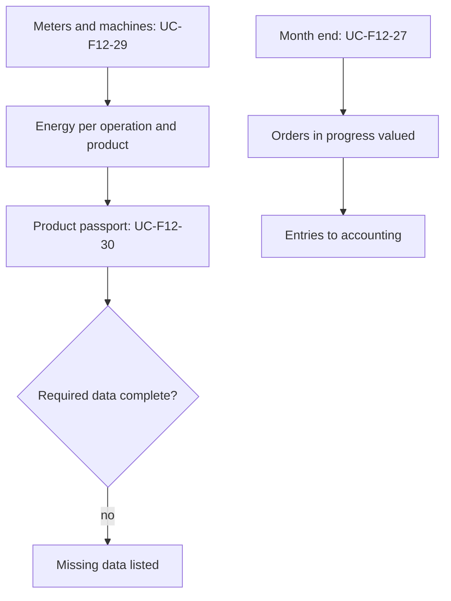

🏠 [Specs](../../../README.md) › 🧩 [Functional capabilities](../../README.md) ›
🏭 [F12 Manufacturing (plugin)](../README.md) › 🔀 [Flows](README.md) ›
🔀 FL-F12-13 Energy, passport and work in progress

# 🔀 FL-F12-13 Energy, passport and work in progress

**Status:** ✅ specified

## Summary

Energy measured per operation, the digital product passport built from production records, and work in progress valued
at month end.

## Personas

- [U05 Accounting](../../../01-users/personas/u05-accounting.md)
- [U21 Production planner](../../../01-users/personas/u21-production-planner.md)
- [U27 Quality manager](../../../01-users/personas/u27-quality-manager.md)

## Flowchart

## Sequence diagram

- [UC-F12-27 Value work in progress at month end](../use-cases/05-subcontracting-and-costs/uc-f12-27-value-work-in-progress-at-month-end.md#sequence-diagram)

## Steps

| Step | Persona | Screen | Use case | What happens |
|---|---|---|---|---|
| 1 | [U21](../../../01-users/personas/u21-production-planner.md) | [S-F12-28](../screens/13-energy-passport-and-work-in-progress/s-f12-28-energy.md) | [UC-F12-29](../use-cases/13-energy-passport-and-work-in-progress/uc-f12-29-measure-energy-per-operation.md) | Read energy per operation |
| 2 | [U27](../../../01-users/personas/u27-quality-manager.md) | [S-F12-29](../screens/13-energy-passport-and-work-in-progress/s-f12-29-product-passport.md) | [UC-F12-30](../use-cases/13-energy-passport-and-work-in-progress/uc-f12-30-build-the-digital-product-passport.md) | Build a product's digital passport |
| 3 | [U05](../../../01-users/personas/u05-accounting.md) | [S-F12-26](../screens/05-subcontracting-and-costs/s-f12-26-work-in-progress.md) | [UC-F12-27](../use-cases/05-subcontracting-and-costs/uc-f12-27-value-work-in-progress-at-month-end.md) | Value work in progress at month end |

### Entities and screens

| Entity | States in this flow | Shown at step and screen | Aggregated view |
|---|---|---|---|
| [E-F12-23 Energy reading](../data/e-f12-23-energy-reading.md) | Recorded | 1 [S-F12-28](../screens/13-energy-passport-and-work-in-progress/s-f12-28-energy.md) | Energy readings |
| [E-F12-09 Equipment](../data/e-f12-09-equipment.md) | Active | Shown elsewhere: [S-F12-08 Maintenance](../screens/04-quality-and-maintenance/s-f12-08-maintenance.md) | Equipments |
| [E-F7-06 Item](../../f07-purchasing-and-stock/data/e-f07-06-item.md) | Active | Shown elsewhere: [S-F7-21 Stock levels](../../f07-purchasing-and-stock/screens/03-replenish/s-f07-21-stock-levels.md) | Items |
| [E-F12-24 Product passport](../data/e-f12-24-product-passport.md) | Draft, Published, Superseded | 2 [S-F12-29](../screens/13-energy-passport-and-work-in-progress/s-f12-29-product-passport.md) | Product passports |
| [E-F8-10 Fiscal period](../../f08-accounting/data/e-f08-10-fiscal-period.md) | Active | Shown elsewhere: [S-F8-01 Books setup](../../f08-accounting/screens/01-set-up-and-post/s-f08-01-books-setup.md) | Fiscal periods |
| [E-F12-04 Manufacturing order](../data/e-f12-04-manufacturing-order.md) | Draft, Confirmed, In progress | 3 [S-F12-26](../screens/05-subcontracting-and-costs/s-f12-26-work-in-progress.md) | Manufacturing orders |
| [E-F8-03 Journal entry](../../f08-accounting/data/e-f08-03-journal-entry.md) | Draft, Posted, Reversed | Shown elsewhere: [S-F8-02 Journal entries](../../f08-accounting/screens/01-set-up-and-post/s-f08-02-journal-entries.md) | Journal entries |

## Errors

A machine without a meter, passport data missing, an order without costs (BR-F12-22, BR-F12-24, BR-F12-25).

## Images

Every step and error, for each persona taking part, in light and dark mode (D120). Steps are numbered as in the Steps
table; E rows are the error cases.

| Step | Persona | Device | Light | Dark |
|---|---|---|---|---|
| 1 | U21 | desktop | [light](../images/13-energy-passport-and-work-in-progress/u21-production-planner/1-energy-desktop-light.png) | [dark](../images/13-energy-passport-and-work-in-progress/u21-production-planner/1-energy-desktop-dark.png) |
| 1 | U21 | phone | [light](../images/13-energy-passport-and-work-in-progress/u21-production-planner/1-energy-phone-light.png) | [dark](../images/13-energy-passport-and-work-in-progress/u21-production-planner/1-energy-phone-dark.png) |
| 2 | U27 | desktop | [light](../images/13-energy-passport-and-work-in-progress/u27-quality-manager/2-product-passport-desktop-light.png) | [dark](../images/13-energy-passport-and-work-in-progress/u27-quality-manager/2-product-passport-desktop-dark.png) |
| 2 | U27 | tablet | [light](../images/13-energy-passport-and-work-in-progress/u27-quality-manager/2-product-passport-tablet-light.png) | [dark](../images/13-energy-passport-and-work-in-progress/u27-quality-manager/2-product-passport-tablet-dark.png) |
| 3 | U05 | desktop | [light](../images/13-energy-passport-and-work-in-progress/u05-accounting/3-work-in-progress-desktop-light.png) | [dark](../images/13-energy-passport-and-work-in-progress/u05-accounting/3-work-in-progress-desktop-dark.png) |
| E1 | U21 | desktop | [light](../images/13-energy-passport-and-work-in-progress/u21-production-planner/e1-energy-refused-desktop-light.png) | [dark](../images/13-energy-passport-and-work-in-progress/u21-production-planner/e1-energy-refused-desktop-dark.png) |
| E1 | U21 | phone | [light](../images/13-energy-passport-and-work-in-progress/u21-production-planner/e1-energy-refused-phone-light.png) | [dark](../images/13-energy-passport-and-work-in-progress/u21-production-planner/e1-energy-refused-phone-dark.png) |

## Open questions

None.

---

⬅️ [FL-F12-12 Quality engineering](fl-f12-12-quality-engineering.md) · ⬆️ [Up](README.md) ·
➡️ [FL-F12-14 CAD, kanban, MPS and tools](fl-f12-14-cad-kanban-mps-and-tools.md)
