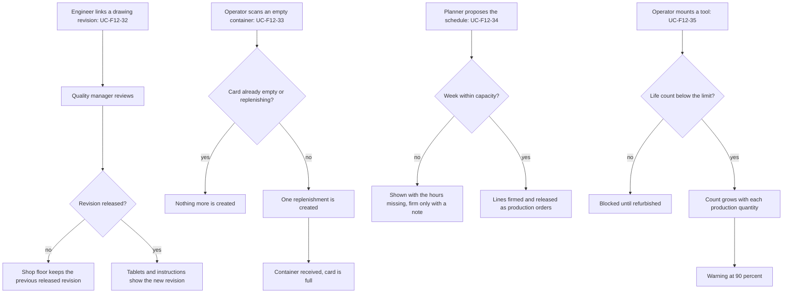
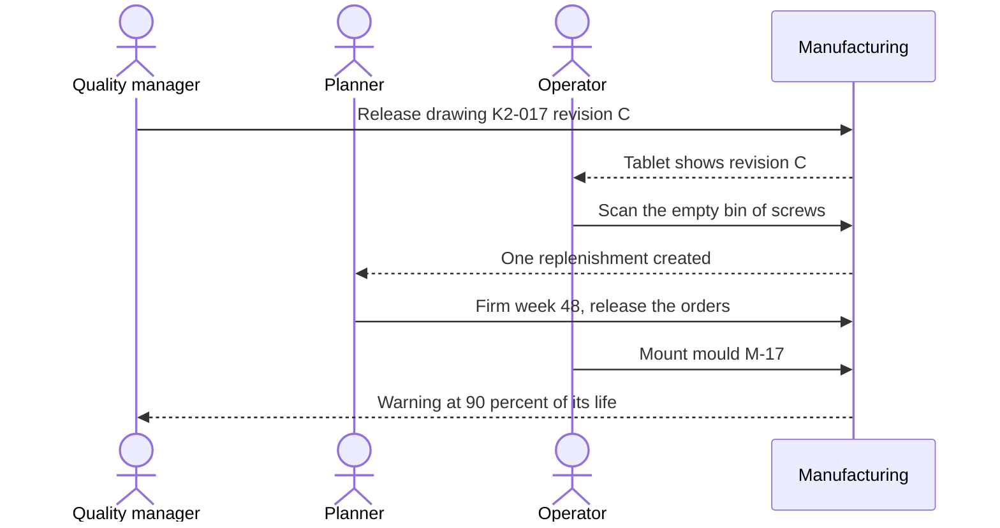

🏠 [Specs](../../../README.md) › 🧩 [Functional capabilities](../../README.md) ›
🏭 [F12 Manufacturing (plugin)](../README.md) › 🔀 [Flows](README.md) › 🔀 FL-F12-14 CAD, kanban, MPS and tools

# 🔀 FL-F12-14 CAD, kanban, MPS and tools

**Status:** ✅ specified

## Summary

Four gaps of manufacturing that benchmarked suites cover and simple-ERP lacked: drawings are linked by revision and only
released revisions reach the shop floor
([UC-F12-32](../use-cases/14-cad-kanban-mps-and-tools/uc-f12-32-link-cad-files-and-revisions.md)), kanban cards
replenish material by what is consumed
([UC-F12-33](../use-cases/14-cad-kanban-mps-and-tools/uc-f12-33-replenish-with-kanban-cards.md)), the master production
schedule plans weeks within capacity
([UC-F12-34](../use-cases/14-cad-kanban-mps-and-tools/uc-f12-34-run-the-master-production-schedule.md)), and tools and
moulds are blocked at the end of their life
([UC-F12-35](../use-cases/14-cad-kanban-mps-and-tools/uc-f12-35-manage-tools-and-moulds.md)). The owner chose each in
the 2026-11-14 interview ([D531](../../../06-decisions/f12-manufacturing/d531-benchmark-gaps-f12-manufacturing.md)).

## Personas

- [U27 Quality manager](../../../01-users/personas/u27-quality-manager.md)
- [U21 Production planner](../../../01-users/personas/u21-production-planner.md)
- [U20 Production operator](../../../01-users/personas/u20-production-operator.md)

## Flowchart

## Sequence diagram

## Steps

| Step | Persona | Screen | Use case | What happens |
|---|---|---|---|---|
| 1 | [U27](../../../01-users/personas/u27-quality-manager.md), [U21](../../../01-users/personas/u21-production-planner.md) | [S-F12-31](../screens/14-cad-kanban-mps-and-tools/s-f12-31-cad-link.md) | [UC-F12-32](../use-cases/14-cad-kanban-mps-and-tools/uc-f12-32-link-cad-files-and-revisions.md) | The quality manager reviews and releases a drawing revision and the planner sees which revision the plan uses |
| 2 | [U20](../../../01-users/personas/u20-production-operator.md), [U21](../../../01-users/personas/u21-production-planner.md) | [S-F12-32](../screens/14-cad-kanban-mps-and-tools/s-f12-32-kanban.md) | [UC-F12-33](../use-cases/14-cad-kanban-mps-and-tools/uc-f12-33-replenish-with-kanban-cards.md) | The operator scans an empty container and the planner follows the card until the container is received |
| 3 | [U21](../../../01-users/personas/u21-production-planner.md) | [S-F12-33](../screens/14-cad-kanban-mps-and-tools/s-f12-33-mps.md) | [UC-F12-34](../use-cases/14-cad-kanban-mps-and-tools/uc-f12-34-run-the-master-production-schedule.md) | The planner builds the schedule, checks each week against capacity, firms and releases the lines |
| 4 | [U20](../../../01-users/personas/u20-production-operator.md), [U27](../../../01-users/personas/u27-quality-manager.md) | [S-F12-34](../screens/14-cad-kanban-mps-and-tools/s-f12-34-tools-and-moulds.md) | [UC-F12-35](../use-cases/14-cad-kanban-mps-and-tools/uc-f12-35-manage-tools-and-moulds.md) | The operator mounts a tool and the quality manager follows its life, services and blocks |

### Entities and screens

| Entity | States in this flow | Shown at step and screen | Aggregated view |
|---|---|---|---|
| [E-F12-30 CAD document](../data/e-f12-30-cad-document.md) | Draft, In review, Released, Superseded, Withdrawn | 1 [S-F12-31](../screens/14-cad-kanban-mps-and-tools/s-f12-31-cad-link.md) | CAD documents |
| [E-F12-31 Kanban card](../data/e-f12-31-kanban-card.md) | Full, Empty, Replenishing, Suspended, Retired | 2 [S-F12-32](../screens/14-cad-kanban-mps-and-tools/s-f12-32-kanban.md) | Kanban cards |
| [E-F12-32 MPS line](../data/e-f12-32-mps-line.md) | Draft, Firm, Released, Closed, Cancelled | 3 [S-F12-33](../screens/14-cad-kanban-mps-and-tools/s-f12-33-mps.md) | MPS lines |
| [E-F12-33 Tool](../data/e-f12-33-tool.md) | Available, In use, Blocked, In maintenance, Retired | 4 [S-F12-34](../screens/14-cad-kanban-mps-and-tools/s-f12-34-tools-and-moulds.md) | Tools |

## Errors

- **E1 A tool is past its life count.** It is blocked and cannot be mounted
  ([BR-F12-30](../business-rules/br-f12-30-a-tool-past-its-life-count-is-blocked.md)), step 4.
- **E2 A revision that is not released.** The shop floor keeps the previous released revision
  ([BR-F12-27](../business-rules/br-f12-27-only-released-revisions-reach-the-shop-floor.md)), step 1.
- **E3 A card scanned twice.** No second replenishment is made
  ([BR-F12-28](../business-rules/br-f12-28-a-card-triggers-one-replenishment.md)), step 2.
- **E4 A week over capacity.** Shown with the hours missing and firmed only with a note
  ([BR-F12-29](../business-rules/br-f12-29-the-mps-stays-within-the-capacity-plan.md)), step 3.

## Images

Every step and error, for each persona taking part, in light and dark mode (D120). Steps are numbered as in the Steps
table; E rows are the error cases.

| Step | Persona | Device | Light | Dark |
|---|---|---|---|---|
| 1 | U21 | desktop | [light](../images/14-cad-kanban-mps-and-tools/u21-production-planner/1-cad-link-desktop-light.png) | [dark](../images/14-cad-kanban-mps-and-tools/u21-production-planner/1-cad-link-desktop-dark.png) |
| 1 | U27 | desktop | [light](../images/14-cad-kanban-mps-and-tools/u27-quality-manager/1-cad-link-desktop-light.png) | [dark](../images/14-cad-kanban-mps-and-tools/u27-quality-manager/1-cad-link-desktop-dark.png) |
| 1 | U21 | desktop | [light](../images/14-cad-kanban-mps-and-tools/u21-production-planner/1-cad-link-desktop-light.png) | [dark](../images/14-cad-kanban-mps-and-tools/u21-production-planner/1-cad-link-desktop-dark.png) |
| 1 | U21 | phone | [light](../images/14-cad-kanban-mps-and-tools/u21-production-planner/1-cad-link-phone-light.png) | [dark](../images/14-cad-kanban-mps-and-tools/u21-production-planner/1-cad-link-phone-dark.png) |
| 1 | U27 | desktop | [light](../images/14-cad-kanban-mps-and-tools/u27-quality-manager/1-cad-link-desktop-light.png) | [dark](../images/14-cad-kanban-mps-and-tools/u27-quality-manager/1-cad-link-desktop-dark.png) |
| 1 | U27 | tablet | [light](../images/14-cad-kanban-mps-and-tools/u27-quality-manager/1-cad-link-tablet-light.png) | [dark](../images/14-cad-kanban-mps-and-tools/u27-quality-manager/1-cad-link-tablet-dark.png) |
| 2 | U20 | tablet | [light](../images/14-cad-kanban-mps-and-tools/u20-production-operator/2-kanban-tablet-light.png) | [dark](../images/14-cad-kanban-mps-and-tools/u20-production-operator/2-kanban-tablet-dark.png) |
| 2 | U21 | desktop | [light](../images/14-cad-kanban-mps-and-tools/u21-production-planner/2-kanban-desktop-light.png) | [dark](../images/14-cad-kanban-mps-and-tools/u21-production-planner/2-kanban-desktop-dark.png) |
| 2 | U20 | tablet | [light](../images/14-cad-kanban-mps-and-tools/u20-production-operator/2-kanban-tablet-light.png) | [dark](../images/14-cad-kanban-mps-and-tools/u20-production-operator/2-kanban-tablet-dark.png) |
| 2 | U21 | desktop | [light](../images/14-cad-kanban-mps-and-tools/u21-production-planner/2-kanban-desktop-light.png) | [dark](../images/14-cad-kanban-mps-and-tools/u21-production-planner/2-kanban-desktop-dark.png) |
| 2 | U21 | phone | [light](../images/14-cad-kanban-mps-and-tools/u21-production-planner/2-kanban-phone-light.png) | [dark](../images/14-cad-kanban-mps-and-tools/u21-production-planner/2-kanban-phone-dark.png) |
| 3 | U21 | desktop | [light](../images/14-cad-kanban-mps-and-tools/u21-production-planner/3-mps-desktop-light.png) | [dark](../images/14-cad-kanban-mps-and-tools/u21-production-planner/3-mps-desktop-dark.png) |
| 3 | U21 | desktop | [light](../images/14-cad-kanban-mps-and-tools/u21-production-planner/3-mps-desktop-light.png) | [dark](../images/14-cad-kanban-mps-and-tools/u21-production-planner/3-mps-desktop-dark.png) |
| 3 | U21 | phone | [light](../images/14-cad-kanban-mps-and-tools/u21-production-planner/3-mps-phone-light.png) | [dark](../images/14-cad-kanban-mps-and-tools/u21-production-planner/3-mps-phone-dark.png) |
| 4 | U20 | tablet | [light](../images/14-cad-kanban-mps-and-tools/u20-production-operator/4-tools-and-moulds-tablet-light.png) | [dark](../images/14-cad-kanban-mps-and-tools/u20-production-operator/4-tools-and-moulds-tablet-dark.png) |
| 4 | U27 | desktop | [light](../images/14-cad-kanban-mps-and-tools/u27-quality-manager/4-tools-and-moulds-desktop-light.png) | [dark](../images/14-cad-kanban-mps-and-tools/u27-quality-manager/4-tools-and-moulds-desktop-dark.png) |
| 4 | U20 | tablet | [light](../images/14-cad-kanban-mps-and-tools/u20-production-operator/4-tools-and-moulds-tablet-light.png) | [dark](../images/14-cad-kanban-mps-and-tools/u20-production-operator/4-tools-and-moulds-tablet-dark.png) |
| 4 | U27 | desktop | [light](../images/14-cad-kanban-mps-and-tools/u27-quality-manager/4-tools-and-moulds-desktop-light.png) | [dark](../images/14-cad-kanban-mps-and-tools/u27-quality-manager/4-tools-and-moulds-desktop-dark.png) |
| 4 | U27 | tablet | [light](../images/14-cad-kanban-mps-and-tools/u27-quality-manager/4-tools-and-moulds-tablet-light.png) | [dark](../images/14-cad-kanban-mps-and-tools/u27-quality-manager/4-tools-and-moulds-tablet-dark.png) |
| E1 | U27 | desktop | [light](../images/14-cad-kanban-mps-and-tools/u27-quality-manager/e1-a-tool-is-past-its-life-count-desktop-light.png) | [dark](../images/14-cad-kanban-mps-and-tools/u27-quality-manager/e1-a-tool-is-past-its-life-count-desktop-dark.png) |
| E1 | U27 | tablet | [light](../images/14-cad-kanban-mps-and-tools/u27-quality-manager/e1-a-tool-is-past-its-life-count-tablet-light.png) | [dark](../images/14-cad-kanban-mps-and-tools/u27-quality-manager/e1-a-tool-is-past-its-life-count-tablet-dark.png) |

## Open questions

None.

---

⬅️ [FL-F12-13 Energy, passport and work in progress](fl-f12-13-energy-passport-and-work-in-progress.md) ·
⬆️ [Up](README.md)
