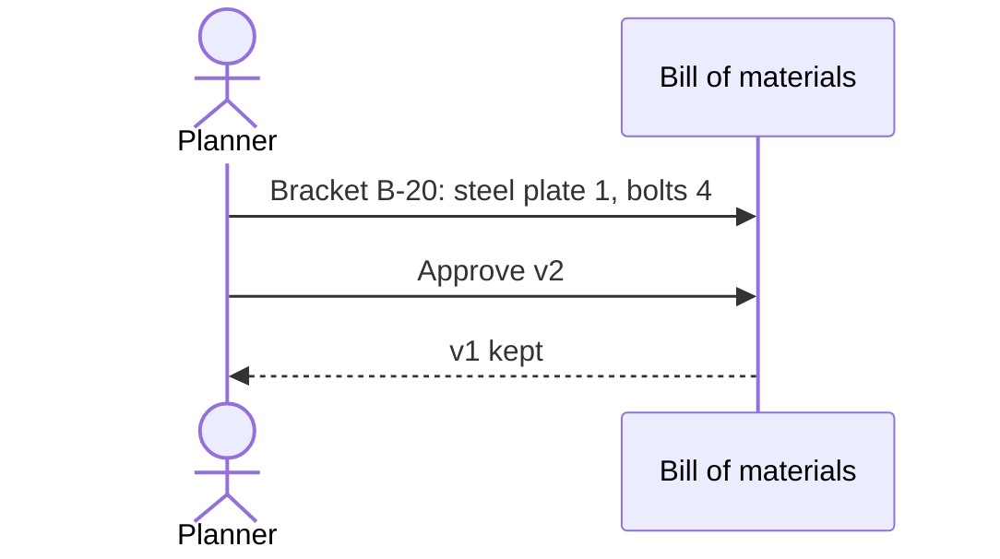

🏠 [Specs](../../../../README.md) › 🧩 [Functional capabilities](../../../README.md) ›
🏭 [F12 Manufacturing (plugin)](../../README.md) › 📝 [Use cases](../README.md) ›
📝 [Use cases: FL-F12-01 Define the products](README.md) › 📝 UC-F12-01 Define bills of materials

# 📝 UC-F12-01 Define bills of materials

**Status:** ✅ specified

## Summary

The planner defines bills of materials: components, quantities, kits, by-products, variants and versions.

## Personas

- [U21 Production planner](../../../../01-users/personas/u21-production-planner.md)

## Goal

Every product's composition right and versioned.

## Trigger

A new product or a change.

## Frequency

Weekly.

## Preconditions

- Components exist as items (F7).

## Postconditions

- **Succeeded:** the bill of materials is approved.
- **Failed:** a loop is refused.

## Main flow

1. The planner creates a bill of materials
   ([S-F12-01](../../screens/01-define-the-products/s-f12-01-bill-of-materials.md)) for a product.
2. They add components with quantities, by-products and variants.
3. Food products use recipes instead
   ([UC-F12-31](../09-recipes-and-batches/uc-f12-31-define-a-recipe-and-produce-in-batches.md)).
4. They approve the version; earlier versions stay
   ([BR-F12-02](../../business-rules/br-f12-02-an-order-keeps-its-versions.md)).

## Alternative flows

- 2a. A kit sold as one product.

## Error flows

- 2e. A component loop: refused.

## Business rules

- [BR-F12-02 An order keeps its versions](../../business-rules/br-f12-02-an-order-keeps-its-versions.md)

## Entities

- [E-F12-01 Bill of materials](../../data/e-f12-01-bill-of-materials.md)

## Permissions

Production planners; managers; record rules by site.

## Notifications

None.

## Audit events

Versions.

## AI involvement

The AI assistant prepares it for confirmation
([BR-F3-07](../../../f03-assistant/business-rules/br-f03-07-no-deletes-no-irreversible-acts.md)); figures come from
queries ([BR-F3-03](../../../f03-assistant/business-rules/br-f03-03-figures-come-from-queries.md)).

## API, MCP and A2A exposure

T5 operations of F12 with the caller's rights; the MCP tool of F12; no A2A skill.

## Screens

- [S-F12-01](../../screens/01-define-the-products/s-f12-01-bill-of-materials.md)

## Flowchart

See [FL-F12-01 Define the products](../../flows/fl-f12-01-define-the-products.md#flowchart).

## Sequence diagram

## Acceptance criteria

1. **Given** bracket B-20 with a steel plate and 4 bolts **when** v2 is approved **then** new orders use v2 and v1 is
   kept.
2. **Given** a component containing its own product **when** it is added **then** it is refused as a loop.
3. **Given** a variant in red **when** it is added **then** the red variant uses the red paint.

## Non-functional notes

None.

## Regulatory references

None.

## Related use cases

See the flows.

- [UC-F12-31 Define a recipe and produce in batches](../09-recipes-and-batches/uc-f12-31-define-a-recipe-and-produce-in-batches.md)

## Open questions

None.

---

⬆️ [Up](README.md) · ➡️ [UC-F12-02 Define work centres and routings](uc-f12-02-define-work-centres-and-routings.md)
