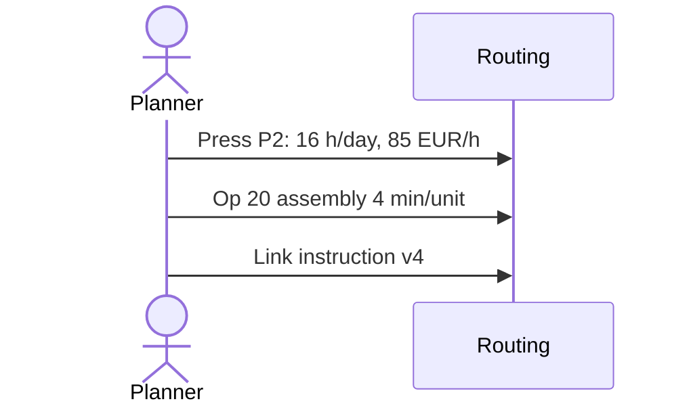

🏠 [Specs](../../../../README.md) › 🧩 [Functional capabilities](../../../README.md) ›
🏭 [F12 Manufacturing (plugin)](../../README.md) › 📝 [Use cases](../README.md) ›
📝 [Use cases: FL-F12-01 Define the products](README.md) › 📝 UC-F12-02 Define work centres and routings

# 📝 UC-F12-02 Define work centres and routings

**Status:** ✅ specified

## Summary

The planner defines work centres with capacity, costs and equipment, and routings with operations, times and
instructions.

## Personas

- [U21 Production planner](../../../../01-users/personas/u21-production-planner.md)

## Goal

How each product is made, at what cost.

## Trigger

A new product or machine.

## Frequency

Monthly.

## Preconditions

- None.

## Postconditions

- **Succeeded:** work centres and routings ready.
- **Failed:** missing capacity warned.

## Main flow

1. The planner creates work centres ([S-F12-02](../../screens/01-define-the-products/s-f12-02-routing.md)) with
   capacity, calendar, cost rates and required qualifications
   ([UC-F12-22](../10-people-and-tools/uc-f12-22-require-operator-qualifications-per-work-centre.md)).
2. They add routing operations with times.
3. Instructions are versioned ([UC-F12-28](../10-people-and-tools/uc-f12-28-publish-versioned-work-instructions.md)).
4. They link equipment.

## Alternative flows

- 1a. An alternative work centre.

## Error flows

- 1e. No capacity set: warned.

## Business rules

- [BR-F12-10 Maintenance frees the plan](../../business-rules/br-f12-10-maintenance-frees-the-plan.md)
- [BR-F12-11 Production costed per order](../../business-rules/br-f12-11-production-costed-per-order.md)

## Entities

- [E-F12-02 Work centre](../../data/e-f12-02-work-centre.md)
- [E-F12-03 Routing operation](../../data/e-f12-03-routing-operation.md)

## Permissions

Production planners; managers; record rules by site.

## Notifications

None.

## Audit events

Changes.

## AI involvement

The AI assistant prepares it for confirmation
([BR-F3-07](../../../f03-assistant/business-rules/br-f03-07-no-deletes-no-irreversible-acts.md)); figures come from
queries ([BR-F3-03](../../../f03-assistant/business-rules/br-f03-03-figures-come-from-queries.md)).

## API, MCP and A2A exposure

T5 operations of F12 with the caller's rights; the MCP tool of F12; no A2A skill.

## Screens

- [S-F12-02](../../screens/01-define-the-products/s-f12-02-routing.md)

## Flowchart

See [FL-F12-01 Define the products](../../flows/fl-f12-01-define-the-products.md#flowchart).

## Sequence diagram

## Acceptance criteria

1. **Given** press P2 at 16 hours a day and 85 EUR an hour **when** it is saved **then** the schedule uses 16 hours.
2. **Given** an operation of 4 minutes per unit **when** an order of 240 is planned **then** it needs 16 hours.
3. **Given** a work centre without capacity **when** it is saved **then** a warning shows.

## Non-functional notes

None.

## Regulatory references

None.

## Related use cases

See the flows.

## Open questions

None.

---

⬅️ [UC-F12-01 Define bills of materials](uc-f12-01-define-bills-of-materials.md) · ⬆️ [Up](README.md) ·
➡️ [UC-F12-03 Plan production](../02-plan-production/uc-f12-03-plan-production.md)
