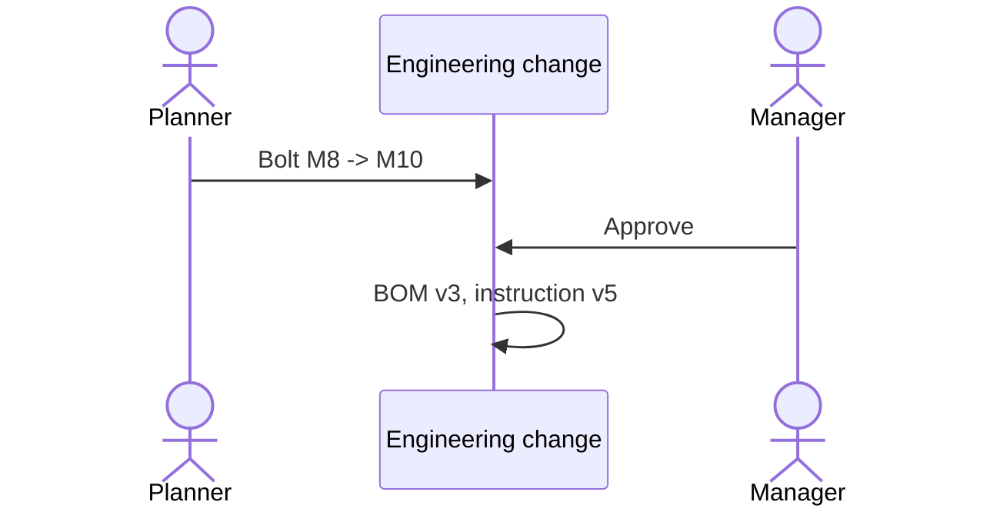

🏠 [Specs](../../../../README.md) › 🧩 [Functional capabilities](../../../README.md) ›
🏭 [F12 Manufacturing (plugin)](../../README.md) › 📝 [Use cases](../README.md) ›
📝 [Use cases: FL-F12-01 Define the products](README.md) › 📝 UC-F12-10 Manage engineering changes

# 📝 UC-F12-10 Manage engineering changes

**Status:** ✅ specified

## Summary

Changes to products, bills of materials and routings are raised, reviewed, approved and versioned.

## Personas

- [U21 Production planner](../../../../01-users/personas/u21-production-planner.md)
- [U02 Manager](../../../../01-users/personas/u02-manager.md)

## Goal

Changes controlled and traced.

## Trigger

A change request.

## Frequency

Monthly.

## Preconditions

F12 set up for the company.

## Postconditions

- **Succeeded:** the new version applies to next orders.
- **Failed:** not approved: old version kept.

## Main flow

1. The planner raises a change on engineering change
   ([S-F12-10](../../screens/01-define-the-products/s-f12-10-engineering-change.md)).
2. Reviewers check its impact (orders, stock, instructions).
3. It is approved; new versions are created
   ([BR-F12-02](../../business-rules/br-f12-02-an-order-keeps-its-versions.md)).
4. Next orders use them; instructions get their new version
   ([UC-F12-28](../10-people-and-tools/uc-f12-28-publish-versioned-work-instructions.md)).

## Alternative flows

- 3a. Urgent change applied to open orders.

## Error flows

- 3e. Not approved: old version kept.

## Business rules

- [BR-F12-02 An order keeps its versions](../../business-rules/br-f12-02-an-order-keeps-its-versions.md)

## Entities

- [E-F12-11 Engineering change](../../data/e-f12-11-engineering-change.md)
- [E-F12-01 Bill of materials](../../data/e-f12-01-bill-of-materials.md)

## Permissions

Production planners; managers; record rules by site. Managers approve.

## Notifications

Reviewers.

## Audit events

Changes and approvals.

## AI involvement

The AI assistant prepares it for confirmation
([BR-F3-07](../../../f03-assistant/business-rules/br-f03-07-no-deletes-no-irreversible-acts.md)); figures come from
queries ([BR-F3-03](../../../f03-assistant/business-rules/br-f03-03-figures-come-from-queries.md)).

## API, MCP and A2A exposure

T5 operations of F12 with the caller's rights; the MCP tool of F12; no A2A skill.

## Screens

- [S-F12-10](../../screens/01-define-the-products/s-f12-10-engineering-change.md)

## Flowchart

See [FL-F12-01 Define the products](../../flows/fl-f12-01-define-the-products.md#flowchart).

## Sequence diagram

## Acceptance criteria

1. **Given** a change of bolt **when** it is approved **then** BOM v3 is created.
2. **Given** open orders **when** the change applies to next orders **then** open ones keep v2.
3. **Given** a refused change **when** it is refused **then** v2 stays current.

## Non-functional notes

None.

## Regulatory references

None.

## Related use cases

See the flows.

- [UC-F12-28 Publish versioned work instructions](../10-people-and-tools/uc-f12-28-publish-versioned-work-instructions.md)

## Open questions

None.

---

⬅️ [UC-F12-09 Subcontract manufacturing](../05-subcontracting-and-costs/uc-f12-09-subcontract-manufacturing.md) ·
⬆️ [Up](README.md) ·
➡️ [UC-F12-11 Unbuild, rework and repair](../03-make-the-products/uc-f12-11-unbuild-rework-and-repair.md)
