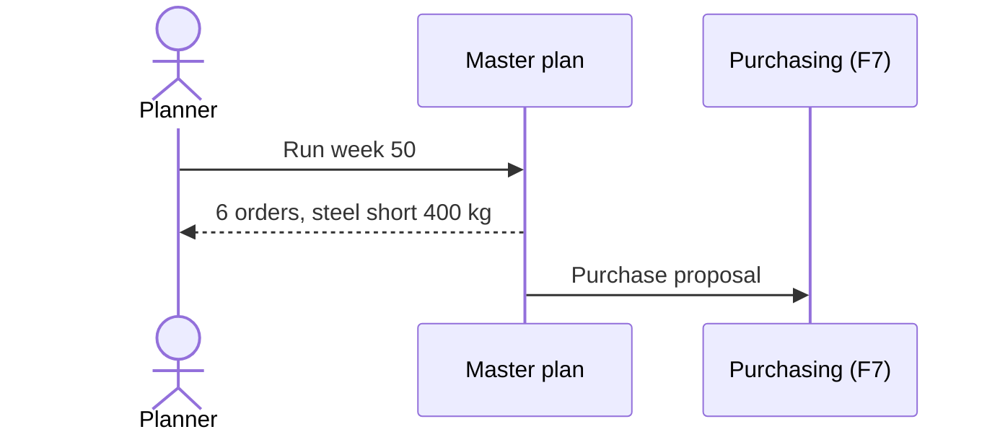

🏠 [Specs](../../../../README.md) › 🧩 [Functional capabilities](../../../README.md) ›
🏭 [F12 Manufacturing (plugin)](../../README.md) › 📝 [Use cases](../README.md) ›
📝 [Use cases: FL-F12-02 Plan production](README.md) › 📝 UC-F12-03 Plan production

# 📝 UC-F12-03 Plan production

**Status:** ✅ specified

## Summary

The planner runs the master plan: forecasts and orders, material requirements and capacity, then releases purchase and
manufacturing proposals.

## Personas

- [U21 Production planner](../../../../01-users/personas/u21-production-planner.md)
- [U04 Purchasing](../../../../01-users/personas/u04-purchasing.md)

## Goal

Make what is needed, buy what is missing.

## Trigger

Daily or weekly planning.

## Frequency

Weekly.

## Preconditions

- Bills of materials and routings.

## Postconditions

- **Succeeded:** proposals released.
- **Failed:** overloads shown per work centre.

## Main flow

1. The planner reviews forecasts and orders on the master plan
   ([S-F12-03](../../screens/02-plan-production/s-f12-03-master-plan.md)).
2. They run the plan: requirements per component and date.
3. Purchase proposals go to F7
   ([UC-F7-05](../../../f07-purchasing-and-stock/use-cases/03-replenish/uc-f07-05-replenish-stock.md)); manufacturing
   proposals are released.
4. Released orders are scheduled on finite capacity
   ([UC-F12-23](../11-finite-schedule-and-the-tablet/uc-f12-23-schedule-with-finite-capacity.md)).

## Alternative flows

- 1a. Make to order or to stock.

## Error flows

- 2e. Capacity overloaded: shown per work centre.

## Business rules

- [BR-F12-03 Components checked before start](../../business-rules/br-f12-03-components-checked-before-start.md)
- [BR-F12-10 Maintenance frees the plan](../../business-rules/br-f12-10-maintenance-frees-the-plan.md)

## Entities

- [E-F12-12 Master plan line](../../data/e-f12-12-master-plan-line.md)
- [E-F12-04 Manufacturing order](../../data/e-f12-04-manufacturing-order.md)
- [E-F7-21 Demand forecast](../../../f07-purchasing-and-stock/data/e-f07-21-demand-forecast.md)

## Permissions

Production planners; managers; record rules by site. Purchasing.

## Notifications

Purchasing: proposals.

## Audit events

Plan runs.

## AI involvement

The AI assistant prepares it for confirmation
([BR-F3-07](../../../f03-assistant/business-rules/br-f03-07-no-deletes-no-irreversible-acts.md)); figures come from
queries ([BR-F3-03](../../../f03-assistant/business-rules/br-f03-03-figures-come-from-queries.md)).

## API, MCP and A2A exposure

T5 operations of F12 with the caller's rights; the MCP tool of F12; no A2A skill.

## Screens

- [S-F12-03](../../screens/02-plan-production/s-f12-03-master-plan.md)

## Flowchart

See [FL-F12-02 Plan production](../../flows/fl-f12-02-plan-production.md#flowchart).

## Sequence diagram

## Acceptance criteria

1. **Given** orders for 1,200 brackets in week 50 **when** the plan runs **then** 6 manufacturing proposals and a steel
   purchase proposal appear.
2. **Given** press P2 overloaded **when** the plan runs **then** it is shown.
3. **Given** a make-to-order product **when** a sales order arrives **then** a manufacturing proposal is linked to it.

## Non-functional notes

A plan of 1,000 items within a minute.

## Regulatory references

None.

## Related use cases

See the flows.

- [UC-F12-23 Schedule with finite capacity](../11-finite-schedule-and-the-tablet/uc-f12-23-schedule-with-finite-capacity.md)

## Open questions

None.

---

⬅️ [UC-F12-02](../01-define-the-products/uc-f12-02-define-work-centres-and-routings.md) · ⬆️ [Up](README.md) ·
➡️ [UC-F12-04](../03-make-the-products/uc-f12-04-launch-and-follow-manufacturing-orders.md)
